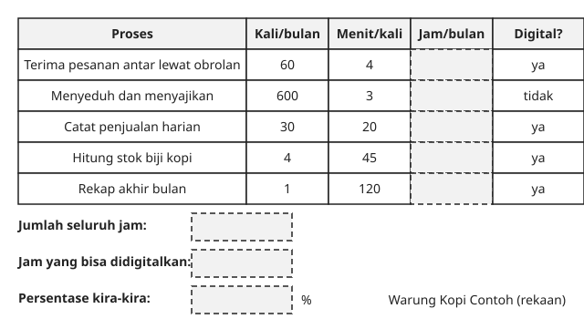

**Ingat dulu:** Tanpa melihat apa pun, tulis tiga tempat Anda menyimpan data usaha atau pelanggan: ______ , ______ , ______

Apa beda data nyata dan data sintetis, dan mengapa latihan hanya memakai yang kedua? ______

`[Gambar: tabel proses Warung Kopi Contoh (rekaan) dengan kolom proses, kali per bulan, menit per kali, jam per bulan (kosong), dan bisa didigitalkan. Di bawah tabel ada tiga kotak kosong: jumlah seluruh jam, jam yang bisa didigitalkan, dan persentasenya.]`

**Prediksi:** Dari seluruh jam kerja sebuah usaha kecil seperti Toko Kue Contoh, kira-kira berapa bagian yang bisa didigitalkan? Lingkari satu: kurang dari seperempat / seperempat sampai separuh / lebih dari separuh.

Alasan Anda: ______

**Lengkapi:** Jam per bulan = ______ kali ______ , dibagi ______ .

Pada gambar, isi kolom jam/bulan, jumlah seluruh jam, jam yang bisa didigitalkan, lalu persentasenya. Pilih satu proses yang bisa didigitalkan dan tulis satu risiko datanya:

Proses: ______ Risiko data: ______

**Latihan:**

1. Pada tabel gambar, pesanan antar lewat obrolan naik menjadi 100 kali sebulan. Prediksi dulu: persentase yang bisa didigitalkan naik atau turun? ______ Hitung jam baru proses itu: ______
2. Buat peta proses untuk usaha **rekaan** Anda sendiri, minimal enam proses, dengan angka kali dan menit rekaan.

| Proses | Kali/bulan | Menit/kali | Jam/bulan | Bisa didigitalkan? |
| --- | --- | --- | --- | --- |
| | | | | |
| | | | | |
| | | | | |
| | | | | |
| | | | | |
| | | | | |

3. Jelaskan: mengapa proses dengan jam terbesar sering tidak masuk daftar yang bisa didigitalkan? ______
4. Skor risiko = kemungkinan (1 sampai 3) dikali dampak (1 sampai 3). Tulis satu risiko usaha rekaan Anda: ______ kemungkinan ___ dampak ___ skor ___ . Satu penangkal: ______

**Cek diri:**

- [ ] Saya bisa menulis rumus jam per bulan dan menyebut satu proses yang bukan kandidat digital.
- [ ] Saya bisa menjelaskan beda mendigitalkan dan mengotomasi.
- [ ] Petaku tidak memuat nama, angka, atau berkas nyata.

**Catatan cetak (untuk fasilitator, tidak dicetak):** satu halaman A4. Kunci ada di modul `dw-bis-m1` bagian "Kunci dan petunjuk". Lembar tidak memuat kolom identitas.
