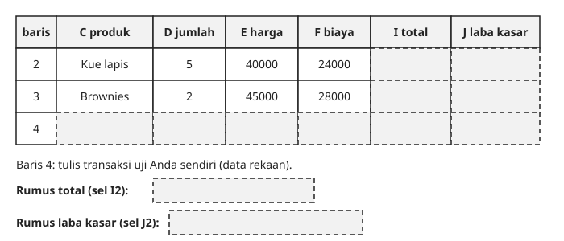

**Ingat dulu:** Bagaimana menghitung jam per bulan sebuah proses? ______

Mengapa proses fisik tidak masuk daftar yang bisa didigitalkan? ______

Apa yang tidak boleh ada di berkas yang Anda bagikan? ______



`[Gambar: potongan lembar kerja Penjualan dengan kolom C produk, D jumlah, E harga, F biaya, I total, dan J laba kasar. Baris 2 Kue lapis 5 buah, harga 40000, biaya 24000. Baris 3 Brownies 2 buah, harga 45000, biaya 28000. Kolom total dan laba kasar kosong, baris 4 kosong untuk transaksi uji, dan dua kotak untuk menulis rumus.]`

**Prediksi:** Tulis prediksi Anda:

1. Total dan laba kasar baris 2: ______ dan ______
2. Total penjualan 200 baris transaksi sintetis: di bawah 10 juta, antara 10 dan 30 juta, atau di atas 30 juta? ______
3. Harga brownies naik pada 1 Maret. Bila kolom pemeriksa membandingkan harga tiap baris dengan daftar harga sekarang, apakah baris brownies bulan Januari "sama" atau "beda"? ______

Isi kolom total dan laba kasar pada gambar, dan tulis kedua rumusnya.

**Lengkapi:** Lengkapi titik-titik:

```text setengah-jadi
Total:               =D2*___
Persentase laba:     =SUM($Penjualan.J2:J1000)/SUM($Penjualan.___2:___1000)
Validasi jumlah:     bilangan bulat dari ___ sampai 100
```

Bila kolom `tanggal` rata kiri, saya periksa dulu apakah ______ .

**Latihan:**

1. Setiap kue dikemas dengan biaya 2.000 per buah. Ubah rumus laba kasar agar memuatnya: ______ Prediksi dulu: laba kasar seluruh tabel naik atau turun? ______
2. Mengapa `harga_satuan` ditulis di tiap transaksi? Tulis satu akibat bila kolom itu selalu mengambil harga dari daftar sekarang: ______
3. Beda laba kasar dan laba bersih: ______
4. Tulis tiga aturan merancang tabel transaksi: ______
5. Sebutkan satu masukan yang membuat rumus total salah, dan satu aturan validasi yang menolaknya: ______

**Cek diri:**

- [ ] Tabel saya satu baris satu transaksi, tanpa sel gabungan.
- [ ] Saya bisa menjelaskan mengapa dua puluh enam baris "beda" bukan kesalahan.
- [ ] Berkas saya tidak memuat data nyata.

**Catatan cetak (untuk fasilitator, tidak dicetak):** satu sampai dua halaman A4. Kunci ada di modul `dw-bis-m2` bagian "Kunci dan petunjuk". Lembar tidak memuat kolom identitas.
