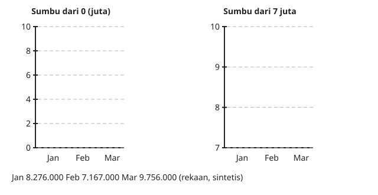

**Ingat dulu:** Mengapa harga dan biaya per baris disalin ke transaksi, bukan hanya diambil dari daftar harga sekarang? ______

Tulis rumus total dan laba kasar untuk satu baris: ______ dan ______

**Prediksi:** Anda akan menggambar grafik batang total penjualan per bulan (Januari, Februari, Maret) dari data sintetis Toko Kue Contoh. Tulis prediksi:

1. Bulan dengan total penjualan terbesar: ______
2. Bila dihitung rata-rata per hari, apakah Februari masih kalah dari Januari? ______
3. Bila sumbu dimulai dari 7 juta, berapa persen tinggi batang Februari dibanding batang tertinggi? ______



`[Gambar: dua bingkai grafik kosong berdampingan. Kiri: sumbu tegak dari 0 sampai 10 juta. Kanan: sumbu tegak dari 7 juta sampai 10 juta. Di bawah tiap sumbu mendatar tertulis Jan, Feb, Mar. Gambarlah tiga batang di tiap bingkai sesuai angka di bawah gambar: Jan 8.276.000, Feb 7.167.000, Mar 9.756.000, lalu bandingkan kesan kedua grafik.]`

**Lengkapi:** Lengkapi titik-titik pada rumus ini (sel `I` berisi total, `G` berisi metode):

```text setengah-jadi
=ROUND(SUM($Penjualan.I2:I1000)/COUNTA($Penjualan.___2:___1000);0)
=COUNTIF($Penjualan.G2:G1000;"___")
=ROUND(SUMIF($Penjualan.G2:G1000;"qris";$Penjualan.I2:I1000)/SUM($Penjualan.___2:___1000);3)
```

Pivot saya benar bila jumlah akhirnya sama dengan ______ .

Pada gambar, apa beda kesan batang Februari di kedua bingkai? ______

**Latihan:**

1. Ubah pivot agar `Data Fields` berisi `laba_kasar`, bukan `total`. Prediksi dulu: berapa jumlah akhirnya? ______
2. Rancang tabel ringkasan per metode pembayaran (tunai, QRIS, transfer): kolom apa saja yang Anda isi? ______
3. Mengapa produk dengan penjualan terbesar belum tentu yang paling menguntungkan? Beri satu keputusan usaha yang bisa berubah karenanya: ______
4. Tulis lima pemeriksaan grafik yang jujur: ______

**Cek diri:**

- [ ] Saya bisa menyebut beda `SUMIF` dan `SUMIFS`.
- [ ] Saya bisa menjelaskan mengapa total Februari lebih kecil dari Januari belum tentu berarti usaha menurun.
- [ ] Saya bisa menyebut satu keterangan wajib di bawah sebuah grafik.

**Catatan cetak (untuk fasilitator, tidak dicetak):** satu halaman A4. Kunci ada di modul `dw-bis-m3` bagian "Kunci dan petunjuk". Lembar tidak memuat kolom identitas.
