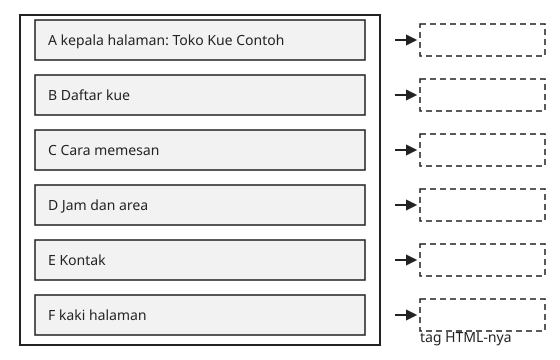

**Ingat dulu:** Mengapa sumbu grafik batang sebaiknya dimulai dari nol? ______

Sebutkan tiga data pribadi yang lazim dikumpulkan sebuah toko dan mengapa data itu menaikkan risiko: ______



`[Gambar: kerangka halaman usaha rekaan dengan enam bagian bertanda A sampai F dari atas: A kepala halaman Toko Kue Contoh, B Daftar kue, C Cara memesan, D Jam dan area, E Kontak, F kaki halaman. Di kanan tiap bagian ada kotak kosong. Tulis di kotak itu tag HTML untuk bagian tersebut.]`

**Prediksi:** Halaman contoh memuat judul usaha, tabel daftar kue (satu baris judul dan tiga kue), dan daftar tiga langkah memesan. Tulis prediksi sebelum membuka halaman di peramban:

1. Apa yang tampil di judul tab peramban? ______
2. Berapa baris tampil di tabel, termasuk baris judul? ______
3. Bila gambar yang ditaut tidak ditemukan tetapi `alt` terisi, apa yang pembaca lihat atau dengar? ______

**Lengkapi:** Lengkapi titik-titik pada halaman usaha rekaan **Warung Kopi Contoh**:

```html setengah-jadi
<html lang="___">
<head>
  <meta ___="viewport" content="width=device-width, initial-scale=1">
  <___>Warung Kopi Contoh</___>
</head>
<body>
  <h1>Warung Kopi Contoh</h1>
  <h2>Menu</h2>
  
</body>
</html>
```

Sebelum membagikan halaman, saya memeriksa ______ .

**Latihan:**

1. Ubah halaman contoh menjadi usaha rekaan Anda sendiri: nama, tiga produk, jam, dan satu surel berakhiran `.example`. Prediksi dulu: bagian kode mana yang Anda ubah, mana yang tidak? ______
2. Bandingkan dua penawaran rekaan. A: domain 120.000 per tahun dan hosting 25.000 per bulan. B: domain gratis tahun pertama lalu 200.000 per tahun, hosting 270.000 per tahun. Biaya tahun pertama A ______ B ______ ; tahun kedua A ______ B ______ . Pelajarannya: ______
3. Tulis daftar periksa "sebelum dibagikan" milik Anda, sepuluh butir atau kurang: ______
4. Beda domain dan hosting, serta beda situs statis dan dinamis: ______

**Cek diri:**

- [ ] Halaman saya tanpa data pribadi atau data pelanggan nyata.
- [ ] Setiap gambar punya `alt` dan hak pakai yang jelas.
- [ ] Tidak ada kata sandi, kunci, atau token di berkas.

**Catatan cetak (untuk fasilitator, tidak dicetak):** satu sampai dua halaman A4. Kunci ada di modul `dw-bis-m4` bagian "Kunci dan petunjuk". Lembar tidak memuat kolom identitas.
