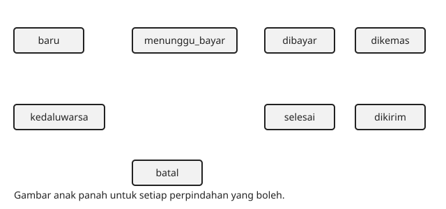

**Ingat dulu:** Jelaskan beda domain dan hosting dengan analogi Anda sendiri: ______

Tulis rumus total dan laba kasar untuk satu baris: ______ dan ______



`[Gambar: delapan kotak status pesanan: baru, menunggu_bayar, dibayar, dikemas, dikirim, selesai, batal, dan kedaluwarsa. Anak panah belum ada. Gambar anak panah untuk setiap perpindahan status yang boleh, lalu tandai satu perpindahan yang tidak boleh.]`

**Prediksi:** Toko Kue Contoh menerima pesanan dua brownies (48.000 per buah, 450 gram per buah) dan satu nastar (85.000, 600 gram). Tarif kirim rekaan zona sedang 15.000 per kilo, berat dibulatkan naik ke kilo penuh.

1. Subtotal ______ ongkos kirim ______ total dibayar pembeli ______
2. Bolehkah pesanan "menunggu bayar" langsung menjadi "dikirim"? ______

**Lengkapi:** Lengkapi fungsi ongkos kirim, lalu hitung 2300 gram ke zona jauh:

```python setengah-jadi
import math

TARIF_PER_KG = {"dekat": 9000, "sedang": 15000, "jauh": 24000}


def ongkir(berat_gram, zona):
    kg = max(math.___(berat_gram / 1000), 1)
    return kg * TARIF_PER_KG[___]
```

Ongkos kirim 2300 gram, zona jauh: ______

Barang boleh saya serahkan bila ______ sudah masuk.

**Susun:** Urutkan langkah alur pesanan dengan menulis huruf dari awal sampai akhir.

- A. kemas
- B. bayar
- C. keranjang
- D. kirim
- E. hitung ongkos kirim
- F. pilih barang
- G. isi alamat
- H. notifikasi pembayaran masuk

Urutan: ______

**Latihan:**

1. Tambahkan status "diretur" yang boleh dicapai dari "dikirim". Prediksi dulu: apakah perpindahan dari "diretur" ke "selesai" diterima? ______
2. Mengapa tangkapan layar "transaksi berhasil" tidak cukup? Tulis dua langkah yang Anda lakukan: ______
3. Tulis apa yang boleh dan tidak boleh disimpan dari data pembayaran.

| Boleh disimpan | Jangan disimpan |
| --- | --- |
| | |

4. Susun katalog lima produk rekaan dengan kolom kode, nama, harga, stok, dan berat. Hitung ongkos kirim dua keranjang rekaan dengan tarif contoh: ______

**Cek diri:**

- [ ] Saya bisa menyebut dua mode QRIS dan beda kode statis dan dinamis.
- [ ] Alurku memuat titik pemeriksaan pembayaran sebelum pengiriman.
- [ ] Semua angka di portofolioku rekaan.

**Catatan cetak (untuk fasilitator, tidak dicetak):** satu sampai dua halaman A4. Kunci ada di modul `dw-bis-m5` bagian "Kunci dan petunjuk". Lembar tidak memuat kolom identitas.
