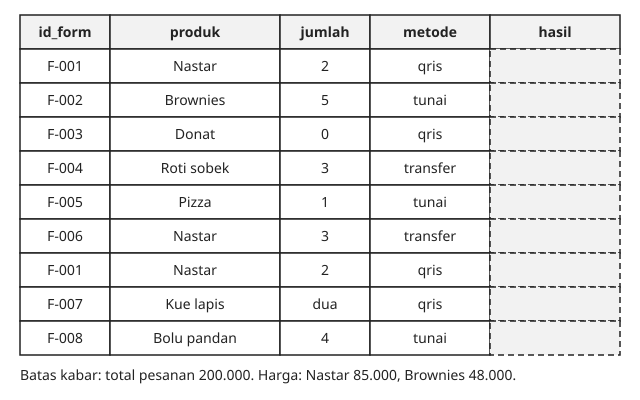

**Ingat dulu:** Sebutkan urutan status pesanan dan satu perpindahan yang tidak boleh: ______

Apa beda total per bulan dan rata-rata per hari, dan kapan yang kedua lebih adil? ______



`[Gambar: tabel sembilan isian formulir sintetis dengan kolom id_form, produk, jumlah, metode, dan kolom hasil yang kosong. Di bawah tabel tertulis batas kabar 200.000 dan harga Nastar 85.000 serta Brownies 48.000. Isian F-001 muncul dua kali.]`

**Prediksi:** Skrip memproses isian pada gambar. Pemberitahuan dikirim bila total pesanan mencapai 200.000. Isian yang sudah tercatat dilewati, dan isian salah masuk antrean tinjau.

1. Berapa isian dicatat ___ , ditolak ___ , berapa pemberitahuan keluar ___ ?
2. Bila formulir yang sama diproses sekali lagi, berapa dicatat ___ dan berapa pemberitahuan baru ___ ?

Tulis hasil tiap isian pada kolom hasil di gambar.

**Lengkapi:** Isi spesifikasi alur untuk usaha rekaan: ulasan baru masuk, ditambah ke daftar ulasan, lalu pemilik diberi kabar.

| Langkah | Pemicu atau aksi | Data | Bila gagal |
| --- | --- | --- | --- |
| 1 | | | |
| 2 | | | |
| 3 | | | |

Lengkapi aturan pemeriksaan tanggal, lalu prediksi hasilnya untuk `"2026-04-01"` dan `"1/4/2026"`:

```python setengah-jadi
def periksa_tanggal(b):
    return len(b["tanggal"]) == ___ and b["tanggal"][4] == "___"
```

Hasil: ______ dan ______

**Latihan:**

1. Toko menerima 40 pesanan per bulan, mencatat tiap pesanan 3 menit. Membuat alur 5 jam, merawatnya 0,5 jam per bulan. Hitung hemat bersih per bulan dan titik impas: ______ Bila pesanan hanya 8 per bulan, apakah otomasi balik modal? ______
2. Tulis spesifikasi satu alur usaha rekaan Anda dengan empat kolom di atas, termasuk kasus gagal.
3. Mengapa isian yang gagal masuk antrean tinjau dan bukan dibuang? ______
4. Tulis lima dari delapan kriteria memilih alat otomasi: ______
5. Pesanan berstatus `dibayar`, lalu isian kedua dengan `id_form` yang sama masuk. Apa yang terjadi bila alur tidak punya penjagaan itu? ______

**Cek diri:**

- [ ] Spesifikasi alur saya punya kolom "bila gagal".
- [ ] Alur saya aman dijalankan dua kali.
- [ ] Saya menghitung titik impas dengan perawatan.

**Catatan cetak (untuk fasilitator, tidak dicetak):** satu sampai dua halaman A4. Kunci ada di modul `dw-bis-m6` bagian "Kunci dan petunjuk". Lembar tidak memuat kolom identitas.
