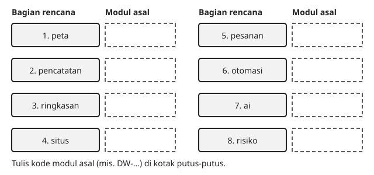

**Ingat dulu:** Tulis dari ingatan: (1) alur pesanan toko daring dari memilih sampai selesai dan titik pemeriksaan pembayarannya; (2) mengapa data kartu, PIN, dan OTP tidak disimpan toko. ______

Bagaimana Anda memeriksa draf teks promosi dan ringkasan ulasan dari AI sebelum dipakai? ______



`[Gambar: delapan bagian rencana dalam dua kolom: 1 peta, 2 pencatatan, 3 ringkasan, 4 situs, 5 pesanan, 6 otomasi, 7 ai, 8 risiko. Di sebelah tiap nama ada kotak putus-putus kosong. Tulis kode modul asal tiap bagian di kotak itu.]`

**Prediksi:** Sebuah skrip membaca `penjualan_sintetis.csv`, menghitung angka usaha, lalu memeriksa rencana rekaan yang sengaja cacat.

1. Berapa transaksi ___ , total penjualan ___ , laba kasar ___ ? Bulan terbesar ______
2. Rencana rekaan itu punya dua cacat. Perkirakan: ______

**Lengkapi:** Tambahkan pola yang menangkap nomor 16 digit (mirip nomor kartu):

```python setengah-jadi
POLA["nomor 16 digit"] = r"\b\d{___}\b"
```

Bila bagian `pesanan` diubah menjadi "Bayar dengan kartu 1111222233334444.", baris apa yang muncul? ______

**Latihan:**

1. Tulis rencana delapan bagian untuk usaha rekaan Anda, tiap bagian satu paragraf atau tabel, dengan sedikitnya satu angka dari data sintetis. (AI: tanpa AI)
2. Tulis lima kriteria penilaian portofolio dan satu arti singkat tiap kriteria: ______
3. Dalam alur otomatis Anda, pemberitahuan pembayaran masuk untuk pesanan yang sudah berstatus `batal`. Apa yang terjadi pada status, dan apa yang dilakukan manusia? ______
4. Rencana Anda menulis "penjualan 25.199.000". Bagaimana Anda memastikan angka itu sama dengan data dan dengan pivot? ______

**Cek diri:**

- [ ] Saya bisa menyebut delapan bagian rencana dan modul asalnya.
- [ ] Saya bisa menyebut lima kriteria penilaian portofolio.
- [ ] Tidak ada data nyata atau kredensial di folder.

**Catatan cetak (untuk fasilitator, tidak dicetak):** satu sampai dua halaman A4. Kunci ada di modul `dw-bis-m8` bagian "Kunci dan petunjuk". Lembar tidak memuat kolom identitas.
