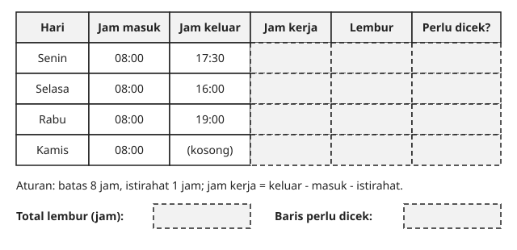

**Ingat dulu:** Tanpa melihat `DW-FND-M1`, tulis tiga aturan tentang kredensial: ______

Apa itu *prompt injection*, dalam satu kalimat? ______

`[Gambar: tabel empat hari log sintetis (Senin sampai Kamis) dengan jam masuk dan jam keluar; jam keluar Kamis kosong. Kolom jam kerja, lembur, dan perlu dicek kosong. Di bawah ada kotak total lembur dan kotak baris perlu dicek. Aturan: batas jam kerja 8, istirahat 1 jam.]`

**Prediksi:** Tiga tugas kantor rekaan: rekap absensi mingguan (4 kali per bulan, 45 menit, 6 jam membuat otomasi), salin faktur ke lembar rekap (20 kali, 10 menit, 5 jam), laporan tahunan unik (sekali setahun, 600 menit, 12 jam). Urutkan dari yang paling layak diotomasi, dan tulis alasan:

______ , ______ , ______ . Alasan: ______

**Lengkapi:** Telusuri algoritma rekap lembur pada gambar. Isi jam kerja, lembur, dan perlu dicek tiap hari, lalu total lembur.

Rumus titik impas: jam hemat per bulan = ______ kali ______ dibagi ______ . Titik impas = ______ dibagi ______ .

**Susun:** Urutkan enam langkah "rekap faktur bulanan" dengan menulis huruf.

- A. Siapkan total nol untuk tiap kategori.
- B. Ambil faktur berikutnya; bila tidak ada lagi, loncat ke E.
- C. Tambahkan nilai faktur ke total kategorinya.
- D. Kembali ke B.
- E. Tulis total tiap kategori ke lembar rekap.
- F. Bila kategori faktur kosong: catat nomor faktur di daftar periksa, lalu kembali ke B tanpa menjalankan C.

Urutan: ______

Satu kasus tidak lazim yang belum ditangani algoritma saya: ______

**Latihan:**

1. Tambahkan tugas "cek stok harian": 22 kali per bulan, 5 menit sekali kerja, 8 jam membuat otomasi. Prediksi dulu titik impasnya: ______ Hitung: ______
2. Pada tugas rekap absensi mingguan, waktu membuat otomasi ternyata 12 jam. Hitung ulang titik impasnya: ______ Apakah keputusan Anda berubah? ______
3. Mengapa "menjawab keluhan pelanggan yang marah" kurang layak diotomasi penuh? Dua alasan: ______
4. Tulis salah satu tugas Anda sebagai algoritma: masukan, langkah bernomor, tiap keputusan dengan syarat dan dua cabang, keluaran. (AI: tanpa AI)

**Cek diri:**

- [ ] Saya bisa menyebut empat pertanyaan kelayakan tugas.
- [ ] Saya bisa menyebut rumus titik impas dan satu hal yang tidak dihitungnya.
- [ ] Setiap keputusan dalam algoritma saya punya syarat dan dua cabang.

**Catatan cetak (untuk fasilitator, tidak dicetak):** satu sampai dua halaman A4. Kunci ada di modul `dw-pkj-m1` bagian "Kunci dan petunjuk". Lembar tidak memuat kolom identitas.
