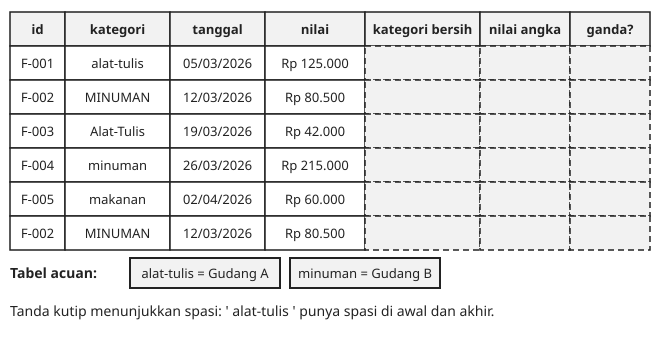

**Ingat dulu:** Sebutkan tiga ciri tugas yang layak diotomasi: ______

Apa beda data nyata dan data sintetis, dan mengapa latihan hanya memakai yang kedua? ______



`[Gambar: tabel enam baris data kotor sintetis dengan kolom id, kategori, tanggal (teks), dan nilai (teks). Kolom kategori bersih, nilai angka, dan ganda kosong. Baris F-002 muncul dua kali, dan F-001 punya spasi di awal dan akhir kategori. Di bawahnya tabel acuan: alat-tulis = Gudang A, minuman = Gudang B.]`

**Prediksi:** Pada gambar, sel kategori F-001 berisi "alat-tulis" dengan spasi di depan dan belakang.

1. Hasil `=LOWER(TRIM(B2))`: ______
2. Hasil `VLOOKUP` untuk "makanan" pada tabel acuan yang hanya memuat "alat-tulis" dan "minuman": ______
3. Berapa baris tertandai "duplikat" bila `F-002` muncul dua kali? ______

Isi kolom kategori bersih, nilai angka, dan ganda pada gambar.

**Lengkapi:** Lengkapi titik-titik:

```text setengah-jadi
=VALUE(SUBSTITUTE(SUBSTITUTE(D2;"Rp ";"");"___";""))
=IF(COUNTIF($A$2:$A$7;A2)___1;"duplikat";"ok")
=SUMIF($E$2:$E$7;"minuman";$___$2:$___$7)
```

Bila ada baris yang tampil `#N/A`, saya mulai mencari penyebabnya di ______ .

**Latihan:**

1. Ubah rumus kategori nilai agar batas "besar" adalah 80000 dan nilai 50000 sampai 79999 bernama "sedang" (`IF` bersarang). Prediksi dulu: berapa baris "besar"? ______
2. Tulis rumus yang mengubah tanggal teks `19/03/2026` menjadi tanggal sungguhan: ______
3. Mengapa hasil pembersihan ditaruh di kolom baru, bukan menimpa data asli? Dua alasan: ______
4. Fungsi `IFERROR` pada `VLOOKUP`: apa gunanya, dan satu risikonya? ______
5. Tulis "bersihkan data faktur bulanan" sebagai algoritma bernomor dengan satu keputusan dan penanganan baris tanpa acuan. (AI: tanpa AI)

**Cek diri:**

- [ ] Data asli tidak saya timpa.
- [ ] Setiap rumus punya tujuan yang tertulis di lembar "Catatan".
- [ ] Saya memeriksa hasil dengan hitungan tangan pada tiga baris.

**Catatan cetak (untuk fasilitator, tidak dicetak):** satu sampai dua halaman A4. Kunci ada di modul `dw-pkj-m2` bagian "Kunci dan petunjuk". Lembar tidak memuat kolom identitas.
