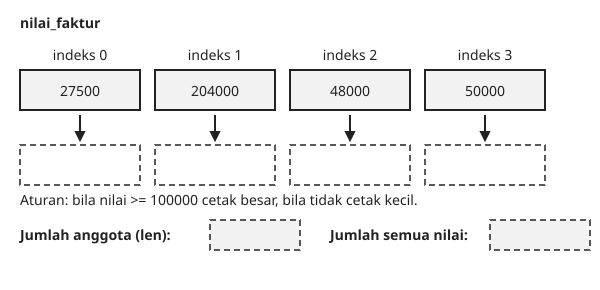

**Ingat dulu:** Tulis rumus yang membuang spasi berlebih dan menyeragamkan huruf, lalu satu alasan memakai kolom baru: ______

Mengapa keluaran asisten AI harus diperiksa sebelum dipakai? ______



`[Gambar: daftar nilai_faktur berisi empat angka 27500, 204000, 48000, 50000 dengan indeks 0 sampai 3 di atas tiap kotak. Di bawah tiap angka ada kotak kosong untuk menulis besar atau kecil menurut aturan nilai >= 100000. Di bawahnya dua kotak kosong: jumlah anggota dan jumlah semua nilai.]`

**Prediksi:** Sel CSV selalu terbaca sebagai teks. Apa yang terjadi pada potongan ini? ______

```python setengah-jadi
baris = {"jumlah": "11", "harga_satuan": "2500"}
print(baris["jumlah"] * baris["harga_satuan"])
```

**Lengkapi:** Pada gambar, tulis keluaran tiap anggota daftar dan isi kedua kotak di bawahnya. Lalu lengkapi dua titik, dan prediksi nilai `total_per_kode(daftar_faktur, "P01")`:

```python setengah-jadi
def total_per_kode(daftar, kode):
    hasil = 0
    for baris in daftar:
        if baris["kode_produk"] == ___:
            hasil += int(baris["jumlah"]) * ___
    return hasil
```

**Susun:** Urutkan baris agar fungsi mengembalikan jumlah dikali harga satu baris CSV.

- A. `    return int(baris["jumlah"]) * int(baris["harga_satuan"])`
- B. `def total_baris(baris):`

Urutan: ______

**Latihan:**

1. Ubah skrip pembaca faktur agar hanya mencetak faktur bernilai 100000 atau lebih. Prediksi dulu banyaknya: ______ (AI: tanpa AI)
2. Tulis fungsi `rata_rata(daftar)` yang mengembalikan rata-rata nilai per faktur: ______
3. Mengapa berkas dibuka dengan `with open(...)`, bukan hanya `open(...)`? Apa yang berubah bila `int()` dihapus dari `total_baris`? ______
4. Tulis ulang rumus `=IF(G2>=100000;"besar";"kecil")` sebagai fungsi Python `ukuran(nilai)`: ______

**Cek diri:**

- [ ] Saya bisa menulis dari ingatan fungsi yang mengembalikan jumlah dikali harga satu baris CSV.
- [ ] Saya bisa menjelaskan mengapa benih acak dicatat.
- [ ] Saya menguji dengan hitungan tangan pada dua baris.

**Catatan cetak (untuk fasilitator, tidak dicetak):** satu sampai dua halaman A4. Kunci ada di modul `dw-pkj-m3` bagian "Kunci dan petunjuk". Lembar tidak memuat kolom identitas.
