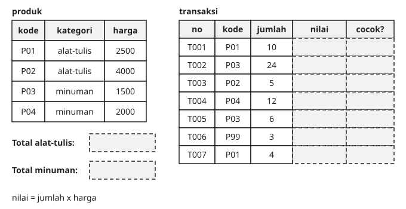

**Ingat dulu:** Mengapa nilai dari CSV harus diubah dengan `int()` sebelum dihitung, dan di mana sebaiknya perubahan itu dilakukan? ______

Apa yang Anda lakukan sebelum menempel teks ke asisten AI? ______



`[Gambar: dua tabel sintetis. Kiri tabel produk (P01 sampai P04 dengan kategori dan harga). Kanan tabel transaksi T001 sampai T007 dengan kode produk dan jumlah, serta kolom nilai dan cocok yang kosong. Di bawah ada dua kotak kosong: total alat-tulis dan total minuman. Nilai = jumlah x harga.]`

**Prediksi:** Pada gambar, tulis dulu sebelum menghitung: (a) transaksi mana berjumlah 10 atau lebih ______ ; (b) transaksi mana yang tidak bisa digabung dengan tabel produk ______ ; (c) kategori mana yang totalnya lebih besar ______

Lalu isi kolom nilai dan cocok serta kedua kotak total.

**Lengkapi:** Hitung total unit per kode produk. Lengkapi titik, lalu prediksi unit `P03`:

```python setengah-jadi
unit_per_kode = defaultdict(int)
for t in transaksi:
    unit_per_kode[t["kode_produk"]] += ___
for kode in sorted(unit_per_kode):
    print(kode, unit_per_kode[kode])
```

Unit P03: ______

**Latihan:**

1. Ubah ambang filter dari 10 menjadi 5. Prediksi dulu daftar transaksinya: ______ (AI: tanpa AI)
2. Hitung rata-rata nilai transaksi per kategori; transaksi yatim tidak ikut. Tulis hasilnya dengan dua angka di belakang koma: ______
3. Mengapa baris yatim dicatat, bukan dibuang? Apa yang terjadi bila kunci ditulis `"p01"` (huruf kecil)? ______
4. Apa beda `d[k]` dan `d.get(k)`? ______
5. Rumus apa di LibreOffice Calc yang setara dengan gabung dengan `.get` dan kelompok dengan `defaultdict`? Sebut dua fungsi: ______

**Cek diri:**

- [ ] Saya bisa menyebut tiga langkah dasar mengolah tabel dan alat Python untuk masing-masing.
- [ ] Baris yatim dicatat dan jumlahnya diperiksa.
- [ ] Saya menguji hasil dengan hitungan tangan pada satu kategori.

**Catatan cetak (untuk fasilitator, tidak dicetak):** satu sampai dua halaman A4. Kunci ada di modul `dw-pkj-m4` bagian "Kunci dan petunjuk". Lembar tidak memuat kolom identitas.
