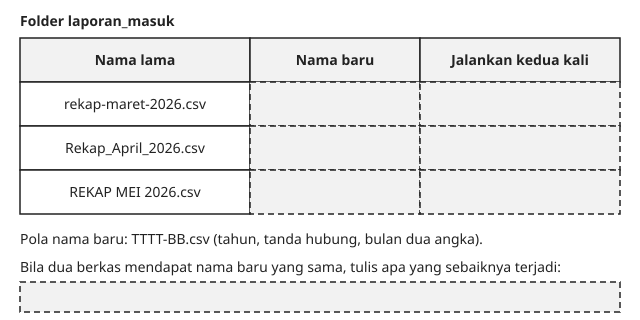

**Ingat dulu:** Apa itu `defaultdict(int)` dan kapan Anda memakainya? ______

Mengapa hasil pembersihan ditaruh di kolom atau berkas baru, bukan menimpa data asli? ______



`[Gambar: tabel tiga nama berkas sintetis di folder laporan_masuk: rekap-maret-2026.csv, Rekap_April_2026.csv, dan REKAP MEI 2026.csv. Kolom nama baru dan kolom hasil bila skrip dijalankan kedua kali masih kosong. Di bawahnya tertulis pola nama baru TTTT-BB.csv dan satu kotak kosong untuk jawaban bila dua berkas mendapat nama sama.]`

**Prediksi:** Skrip akan menamai ulang ketiga berkas pada gambar menjadi `TTTT-BB.csv`. Tulis prediksi Anda pada gambar: (a) nama baru ketiganya; (b) apa yang tercetak bila skrip yang sama dijalankan untuk kedua kalinya; (c) apa yang sebaiknya terjadi bila dua berkas akan mendapat nama baru yang sama.

**Lengkapi:** Tambahkan pemeriksaan berkas kosong. Isi titik, lalu prediksi apa yang tercetak pada folder sebelum berkas `kosong.csv` dibuat:

```python setengah-jadi
for berkas in sorted(folder.glob("*.csv")):
    if berkas.stat().st_size ___ 0:
        print("kosong:", berkas.name)
```

Prediksi: ______

**Latihan:**

1. Jalankan `nama_baru("rekap-juni.csv")` dan `nama_baru("Rekap Juni 2026 (final).csv")`. Prediksi dulu hasil keduanya: ______ dan ______ . Mengapa berkas pertama masuk daftar `dilewati`? ______ (AI: tanpa AI)
2. Mengapa ada uji coba lebih dulu, dan mengapa skrip memeriksa nama tujuan yang sudah ada sebelum mengganti nama apa pun? ______
3. Pada berkas Mei, `P01` dan `P02` sama-sama terjual 16 unit. Siapa yang dipilih, dan mengapa aturan seri harus Anda putuskan sendiri? ______
4. Apa beda `Path.rename` dan `shutil.copy` terhadap berkas asal? ______
5. Bagaimana Anda memeriksa total laporan benar tanpa mempercayai skrip? ______

**Cek diri:**

- [ ] Saya bisa menyebut tiga ciri skrip ganti nama yang aman.
- [ ] Baris rusak dicatat, dan saya mencocokkan satu total dengan hitungan tangan.
- [ ] Hanya folder sintetis yang saya sentuh.

**Catatan cetak (untuk fasilitator, tidak dicetak):** satu sampai dua halaman A4. Kunci ada di modul `dw-pkj-m5` bagian "Kunci dan petunjuk". Lembar tidak memuat kolom identitas.
