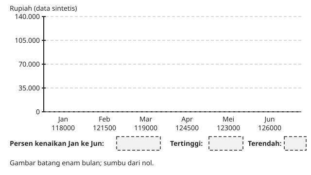

**Ingat dulu:** Mengapa keluaran AI yang meyakinkan tetap diperlakukan sebagai draf dan diuji dengan kasus yang mencakup nol dan kosong? ______

Mengapa kunci gabung harus dibersihkan (spasi, huruf) sebelum dua tabel digabung? ______



`[Gambar: bingkai grafik kosong dengan sumbu tegak 0 sampai 140.000 rupiah. Di bawah sumbu mendatar enam bulan Jan sampai Jun dengan total sintetis 118000, 121500, 119000, 124500, 123000, 126000. Di bawahnya tiga kotak kosong: persen kenaikan Jan ke Jun, bulan tertinggi, dan bulan terendah. Gambarlah enam batang.]`

**Prediksi:** Sebelum menghitung, tulis: (a) persen kenaikan Januari ke Juni ______ ; (b) berapa kali tinggi batang Juni dibanding Januari bila sumbu dari 0 ______ dan bila sumbu dipotong di 115000 ______ ; (c) grafik mana yang membuat pembaca mengira penjualan melonjak? ______

Lalu gambar keenam batang pada gambar dan isi tiga kotak.

**Lengkapi:** Tambahkan label nilai di atas tiap batang pada skrip grafik. Isi titik:

```python setengah-jadi
        bagian.append(
            f'<text x="{x + lebar_batang / 2:.1f}" y="{y - ___:.1f}" font-size="10" text-anchor="middle">{format_angka(n)}</text>'
        )
```

Label berada di atas atau di bawah puncak batang? ______ Angka itu ditambah atau dikurangi dari `y`? ______

**Latihan:**

1. Tulis lima pemeriksaan grafik jujur: ______
2. Pada grafik batang, mengapa sumbu dari nol? Apa yang wajib Anda tulis bila sumbu tidak dari nol? ______
3. Susun judul grafik yang menyatakan temuan dari data pada gambar: ______
4. Tulis rumus Calc untuk persen perubahan Januari ke Juni dan untuk bulan tertinggi, bila bulan di `A2:A7` dan total di `B2:B7`: ______
5. Transaksi `[("Jan", 50000), ("Feb", 30000), ("Jan", 68000), ("Feb", 91500)]`: jumlahkan per bulan dengan `defaultdict(int)` dan tulis hasilnya: ______ (AI: tanpa AI)

**Cek diri:**

- [ ] Saya bisa menyebut empat bagian ringkasan satu halaman.
- [ ] Sumbu batang saya dari nol dan satuannya tertulis.
- [ ] Hal yang mengganggu pesan dicatat, bukan disembunyikan.

**Catatan cetak (untuk fasilitator, tidak dicetak):** satu sampai dua halaman A4. Kunci ada di modul `dw-pkj-m7` bagian "Kunci dan petunjuk". Lembar tidak memuat kolom identitas.
