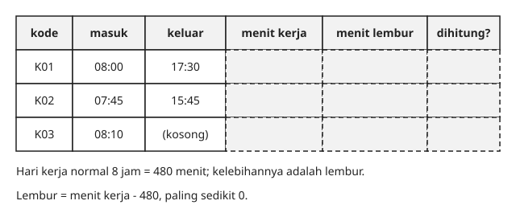

**Ingat dulu:** Hitung titik impas satu tugas (jam membuat otomasi dibagi jam hemat per bulan) dan sebut satu hal yang tidak dihitung rumus itu: ______

Tulis dari ingatan kerangka membaca CSV dengan `csv.DictReader`: ______



`[Gambar: tabel tiga baris absensi sintetis: K01 masuk 08:00 keluar 17:30, K02 masuk 07:45 keluar 15:45, K03 masuk 08:10 keluar kosong. Kolom menit kerja, menit lembur, dan dihitung kosong. Di bawah tertulis: hari kerja normal 480 menit, lembur = menit kerja - 480, paling sedikit 0.]`

**Prediksi:** Isi tabel pada gambar: menit kerja dan menit lembur tiap baris, dan baris mana yang tidak boleh ikut dihitung. Tulis alasannya: ______

**Lengkapi:** Lengkapi pembanding pada fungsi pemeriksa:

```python setengah-jadi
def hitung_hari(masuk, keluar):
    selisih = menit(keluar) - menit(masuk)
    if selisih ___ 0:
        raise ValueError("keluar tidak setelah masuk")
    return selisih, max(0, selisih - BATAS_NORMAL)
```

Bila Anda menulis `<` alih-alih tanda yang benar, apa yang terjadi pada baris dengan masuk dan keluar yang sama? ______

**Susun:** Urutkan lima tahap alur otomasi absensi dengan menulis huruf.

- A. hitung jam kerja dan lembur per karyawan
- B. periksa kode dikenal dan jam keluar setelah masuk
- C. keluaran `rekap.csv`
- D. bersihkan kode dengan `.strip().upper()`
- E. masukan `karyawan.csv` dan `absensi.csv`

Urutan: ______ Satu tahap penutup yang menyusul: ______

**Latihan:**

1. Ubah `BATAS_NORMAL` menjadi `7 * 60`. Prediksi dulu: apa yang terjadi pada `uji_cepat()`? ______
2. Mengapa baris bermasalah dicatat, bukan dibuang? Apa yang dijaga oleh `assert` yang membandingkan jumlah baris? ______
3. Tulis dokumentasi untuk alur Anda sendiri dengan delapan baris: tujuan, cara menjalankan, masukan, keluaran, aturan, pemeriksaan, batas, pemakaian AI. (AI: tanpa AI)
4. Rancang satu grafik batang jam lembur per karyawan dengan sumbu dari nol. Tulis judul yang menyatakan temuan: ______

**Cek diri:**

- [ ] Saya bisa menyebut lima tahap alur otomasi dari masukan sampai dokumentasi.
- [ ] Saya bisa menyebut lima butir rubrik portofolio.
- [ ] Tidak ada kredensial atau data nyata di folder.

**Catatan cetak (untuk fasilitator, tidak dicetak):** satu sampai dua halaman A4. Kunci ada di modul `dw-pkj-m8` bagian "Kunci dan petunjuk". Lembar tidak memuat kolom identitas.
