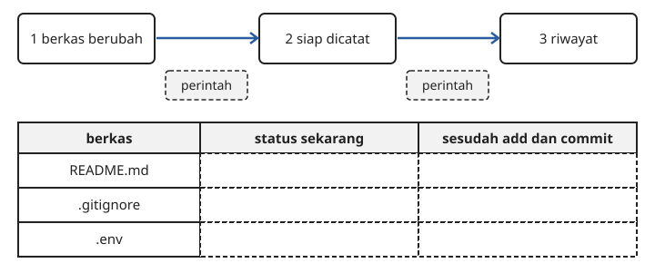

**Ingat dulu:** Tanpa melihat catatan, jawab singkat.

1. Sebutkan tiga aturan tentang kredensial. ______
2. Apa itu *prompt injection*, dalam satu kalimat? ______
3. Apa yang dilakukan `.gitignore` terhadap berkas yang sudah pernah di-commit? ______



`[Gambar: tiga kotak berurutan berlabel "1 berkas berubah", "2 siap dicatat", dan "3 riwayat", dihubungkan dua panah. Di bawah tiap panah ada kotak kosong bernama "perintah" yang Anda isi. Di bawahnya tabel tiga baris (README.md, .gitignore, .env) dan dua kolom kosong: status sekarang dan status sesudah add dan commit.]`

**Prediksi:** Di folder kosong `proyek-contoh` Anda menjalankan `git init`, membuat `README.md`, membuat `.gitignore` berisi tiga baris (`.venv/`, `.env`, `__pycache__/`), dan membuat berkas `.env`. Isi kotak perintah dan tabel pada gambar, lalu tulis:

1. Isi `git status --short` sekarang: ______
2. Isinya sesudah `git add README.md .gitignore` dan `git commit`: ______

**Lengkapi:** Lengkapi `.gitignore` agar berkas log dan lingkungan virtual diabaikan.

```bash setengah-jadi
printf '___/\n*.___\n.env\n' > .gitignore
```

Bila Anda membuat `debug.log`, apakah `git status --short` menampilkannya? ______

**Latihan:**

1. Tambahkan `*.log` ke `.gitignore`, buat `debug.log`, dan tulis dulu isi `git status --short` yang Anda harapkan. ______
2. Jelaskan beda `git add` dan `git commit`, dan mengapa pesan "oops" buruk. Beri satu pesan commit yang baik. ______
3. `.env` Anda ternyata sudah ter-commit dua hari lalu. Tulis urutan langkah dan apa yang tidak bisa dibatalkan. ______

**Cek diri:**

- [ ] Saya dapat menulis urutan perintah dari berkas berubah sampai tercatat di riwayat.
- [ ] Saya tahu apa yang ditunjukkan `git status --short` dan arti `??`.
- [ ] Saya tahu langkah bila kredensial terlanjur ter-commit.

**Catatan cetak (untuk fasilitator, tidak dicetak):** satu lembar per peserta, satu halaman A4. Kunci ada di modul `dw-pro-m1`, bagian "Kunci dan petunjuk". Lembar tidak memuat kolom nama, tanggal, atau nilai; pencatatan diurus fasilitator.
