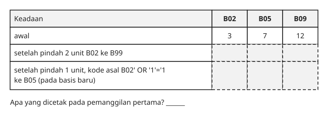

**Ingat dulu:** Mengapa layanan memeriksa sendiri isian walaupun halaman sudah memeriksanya? ______

Sebutkan enam langkah menelusuri galat dan mengapa uji yang menemukan galat disimpan: ______



`[Gambar: tabel stok tiga barang B02, B05, B09 pada awal: 3, 7, 12. Dua baris di bawahnya kosong untuk diisi: stok sesudah memindahkan 2 unit dari B02 ke B99 yang tidak ada, dan stok sesudah memindahkan 1 unit dari kode asal B02' OR '1'='1 ke B05 (pada basis baru). Di bawah tabel ada isian apa yang dicetak pada pemanggilan pertama.]`

**Prediksi:** Sejawat mengirim fungsi ini. Sebelum menjalankan apa pun, tulis daftar masalah sebanyak yang Anda temukan (target empat atau lebih): ______

```python
def pindah_stok(conn, dari, ke, jumlah):
    try:
        conn.execute("UPDATE barang SET stok = stok - " + str(jumlah) + " WHERE kode = '" + dari + "'")
        conn.execute("UPDATE barang SET stok = stok + ? WHERE kode = ?", (jumlah, ke))
        conn.commit()
    except:
        print("gagal")
```

Isi dua baris kosong pada gambar.

**Lengkapi:** Tambahkan pemeriksaan "galat ditelan diam-diam" pada pemeriksa mini, yaitu penangan galat yang isinya hanya `pass`:

```python setengah-jadi
        if isinstance(simpul, ast.ExceptHandler) and all(isinstance(s, ast.___) for s in simpul.body):
            temuan.append(f"baris {simpul.lineno}: galat ditelan diam-diam")
```

Apakah `except:` bertubuh `pass` ditandai oleh pemeriksaan ini? ______

**Latihan:**

1. Tulis tinjauan lima komentar untuk kode di atas. Tiap komentar memuat apa yang terlihat, mengapa penting, dan saran, dengan tingkat "harus diperbaiki" atau "saran": ______ (AI: tanpa AI)
2. Ubah spesifikasi: `pindah_stok` mengembalikan stok akhir asal dan tujuan sebagai pasangan. Mana yang Anda ubah lebih dulu, kode atau uji? Mengapa? ______
3. Apa yang dibuktikan uji integrasi yang tidak dibuktikan uji unit? Mengapa uji integrasi sebaiknya sedikit? ______
4. Draf AI untuk `pindah_stok` memuat `import requests` yang tidak dipakai. Tulis komentar tinjauan dan langkah sebelum paket itu dipasang: ______ (AI: boleh)
5. Apa yang diperiksa dan tidak diperiksa pemeriksa mini berbasis `ast`? ______

**Cek diri:**

- [ ] Saya bisa menyebut tiga masalah pada kiriman awal dan satu komentar tinjauan untuk salah satunya.
- [ ] Komentar saya bertingkat (harus atau saran) dan menyebut buktinya.
- [ ] Saya tidak menyetujui kode yang tidak saya pahami.

**Catatan cetak (untuk fasilitator, tidak dicetak):** dua halaman A4. Kunci ada di modul `dw-pro-m10` bagian "Kunci dan petunjuk". Lembar tidak memuat kolom identitas.
