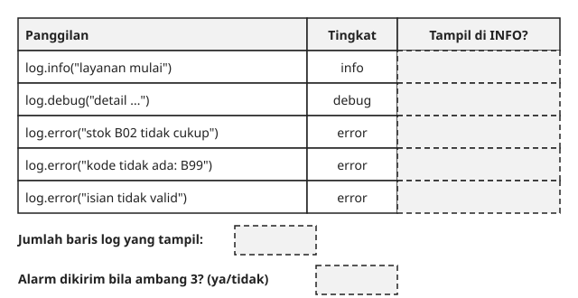

**Ingat dulu:** Apa beda uji unit dan uji integrasi, dan satu hal yang tidak ditemukan analisis statis? ______

Apa yang ditaruh di berkas konfigurasi dan apa yang tidak? ______



`[Gambar: tabel lima panggilan log: info "layanan mulai", debug "detail ...", dan tiga error (stok B02 tidak cukup, kode tidak ada B99, isian tidak valid). Kolom "Tampil di INFO?" kosong. Di bawah ada dua kotak kosong: jumlah baris log yang tampil dan apakah alarm dikirim bila ambang 3.]`

**Prediksi:** Konfigurasi `produksi` memakai tingkat `INFO` dan ambang alarm 3. Tulis tanpa menjalankan: (a) apa yang terjadi bila `produksi` dimuat tanpa variabel lingkungan `GUDANG_TOKEN_ALERT`? ______ (b) isi kolom tampil dan kotak jumlah baris pada gambar; (c) apakah alarm dikirim (kotak di gambar)?

**Lengkapi:** Lengkapi `periksa_alarm`:

```python setengah-jadi
def periksa_alarm(baris_log, ambang, kirim):
    jumlah = sum(1 for baris in baris_log if baris.___("ERROR "))
    if jumlah ___ ambang:
        kirim(f"{jumlah} galat pada jendela log")
        return True
    return False
```

Apakah alarm terkirim pada tiga galat bila lubang kedua diisi `>`? ______

**Latihan:**

1. Mengapa produksi gagal cepat bila token tidak ada, dan apa risikonya bila pesan galat mencetak seluruh konfigurasi? ______
2. Tulis urutan pembaruan layanan dari membaca catatan rilis sampai mengamati log: ______ Kapan rencana mundur ditulis? ______
3. Apa yang dicatat di log dan apa yang tidak? ______
4. Tambahkan lingkungan `staging` (port 8090, tingkat `INFO`, token wajib). Mana yang diubah lebih dulu, kode atau uji? ______ (AI: tanpa AI)
5. Apa yang terjadi pada migrasi kedua bila gagal? Mengapa migrasi aman diulang? ______

**Cek diri:**

- [ ] Saya bisa menjelaskan mengapa token berasal dari variabel lingkungan.
- [ ] Log tidak memuat data pribadi atau token, dan tingkatnya diatur.
- [ ] Sebelum pembaruan ada cadangan, uji, dan rencana mundur.

**Catatan cetak (untuk fasilitator, tidak dicetak):** satu sampai dua halaman A4. Kunci ada di modul `dw-pro-m11` bagian "Kunci dan petunjuk". Lembar tidak memuat kolom identitas.
