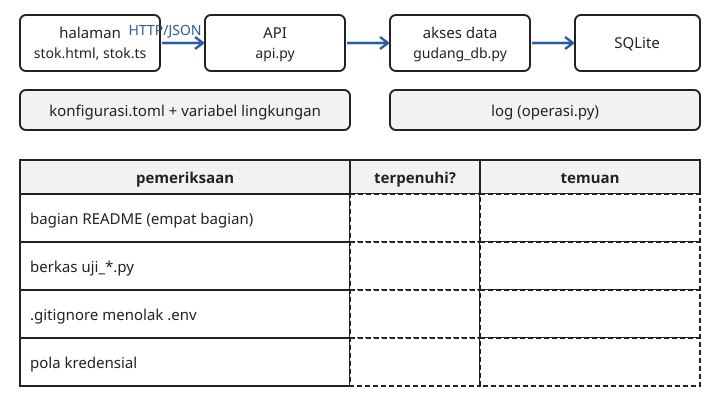

**Ingat dulu:** Tanpa melihat catatan, jawab singkat.

1. Apa yang tidak boleh masuk log dan di mana token ditaruh? ______
2. Bagaimana Anda membatasi kewenangan agen kode, dan siapa yang meninjau hasilnya sebelum digabung? ______
3. Mengapa uji ditulis untuk kasus kosong, batas, dan nilai yang tidak ada, bukan hanya kasus biasa? ______



`[Gambar: rantai kotak berpanah dari "halaman (stok.html, stok.ts)" ke "API (api.py)", ke "akses data (gudang_db.py)", ke "SQLite"; di bawahnya kotak "konfigurasi.toml + variabel lingkungan" dan "log (operasi.py)". Di bawah rantai ada tabel empat pemeriksaan portofolio (bagian README, berkas uji, .gitignore menolak .env, pola kredensial) dengan kolom kosong "terpenuhi?" dan "temuan". Kerjakan: isi tabel untuk folder pada soal Prediksi.]`

**Prediksi:** Sebuah folder proyek berisi `README.md` dengan bagian `Cara menjalankan`, `Cara menguji`, `Konfigurasi` (tanpa `Batasan`); `uji_gudang.py`; `.gitignore` berisi hanya `.venv/`; dan `konfigurasi.toml` berisi `token = "abcd1234efgh"`. Pemeriksa portofolio memeriksa bagian README, berkas uji, `.gitignore` yang menolak `.env`, dan pola kredensial. Isi tabel pada gambar, lalu tulis berapa temuan dan apa saja: ______

**Lengkapi:** Lengkapi pemeriksaan `.gitignore` di pemeriksa.

```python setengah-jadi
    ignore = folder / ".gitignore"
    if not ignore.exists() or ".env" ___ ignore.read_text(encoding="utf-8").splitlines():
        temuan.append(".gitignore tidak menolak .env")
```

Mengapa daftar baris dipakai, bukan mencari `.env` langsung di teksnya? ______

**Latihan:**

1. Tulis lima skenario UAT untuk dua peran sintetis (kasir dan pengelola gudang): tujuan, langkah, dan hasil yang diharapkan, dalam tabel. ______
2. Dalam satu paragraf, jelaskan rancangan inventaris Anda: lapisan, alasan memilih SQLite dan `http.server`, dan apa yang diganti untuk pemakaian sungguhan. ______
3. Tulis urutan perintah Git dari berkas berubah sampai tercatat, dan satu perintah untuk memastikan `.env` tidak ikut. ______

**Cek diri:**

- [ ] Saya dapat menulis dua kriteria penerimaan yang dapat diuji untuk aplikasi pilihan saya.
- [ ] Saya tahu apa yang diperiksa UAT dan tidak diperiksa uji unit.
- [ ] Saya tahu apa yang diperiksa sebelum repositori dibagikan.

**Catatan cetak (untuk fasilitator, tidak dicetak):** satu lembar per peserta, dua halaman A4. Kunci ada di modul `dw-pro-m12`, bagian "Kunci dan petunjuk". Lembar tidak memuat kolom nama, tanggal, atau nilai; pencatatan diurus fasilitator.
