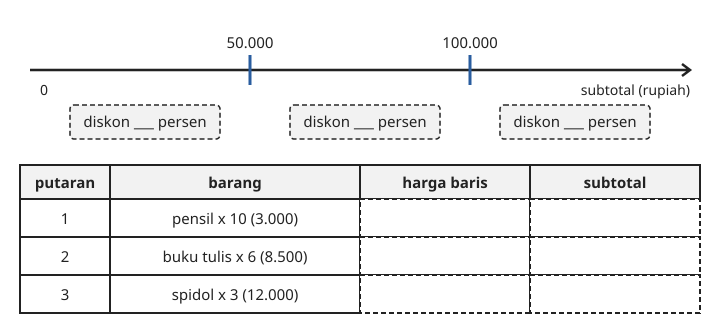

**Ingat dulu:** Tanpa melihat catatan, jawab singkat.

1. Tulis urutan perintah Git dari berkas berubah sampai tercatat di riwayat, dan apa yang ditunjukkan `git status --short`. ______
2. Sebutkan tiga aturan tentang kredensial. ______



`[Gambar: garis bilangan subtotal dengan tanda 50.000 dan 100.000 yang membagi tiga daerah; tiap daerah punya kotak kosong "diskon ___ persen". Di bawahnya tabel penelusuran tiga putaran: pensil x 10 (3.000), buku tulis x 6 (8.500), spidol x 3 (12.000), dengan kolom "harga baris" dan "subtotal" kosong.]`

**Prediksi:** Toko memberi diskon bertingkat: 10 persen untuk subtotal sejak 100.000 dan 5 persen sejak 50.000. Isi gambar, lalu tulis:

1. Persen diskon untuk subtotal 49.999, 50.000, dan 100.000: ______
2. Keranjang 10 pensil (3.000), 6 buku tulis (8.500), dan 3 spidol (12.000). Subtotal ______, diskon ______, total ______.

**Lengkapi:** Aturan ongkos kirim rekaan: gratis bila subtotal sejak 75.000, selain itu 10.000.

```python setengah-jadi
def ongkos_kirim(subtotal):
    if subtotal >= ___:
        return 0
    return ___
```

Hasil `ongkos_kirim(74999)`: ______ dan `ongkos_kirim(75000)`: ______

Tulis dua kasus uji untuk batas itu:

______

______

**Latihan:**

1. Tambahkan tingkat 15 persen sejak 200.000 ke `diskon_persen`. Tulis dulu hasil `diskon_persen(200000)`. ______
2. Tulis `rata_rata_belanja(daftar_total)` yang mengembalikan `None` untuk daftar kosong. Tulis empat kasus uji sebelum fungsinya. ______
3. Jelaskan mengapa `harga_baris` memunculkan galat untuk barang tak dikenal dan bukan mengembalikan 0. ______

**Cek diri:**

- [ ] Saya dapat membedakan variabel, kondisi, perulangan, dan fungsi, masing-masing dengan satu contoh.
- [ ] Saya dapat memecah masalah dengan kartu enam baris.
- [ ] Saya tahu mengapa ambang diuji di kedua sisi batas.

**Catatan cetak (untuk fasilitator, tidak dicetak):** satu lembar per peserta, satu halaman A4. Kunci ada di modul `dw-pro-m2`, bagian "Kunci dan petunjuk". Lembar tidak memuat kolom nama, tanggal, atau nilai; pencatatan diurus fasilitator.
