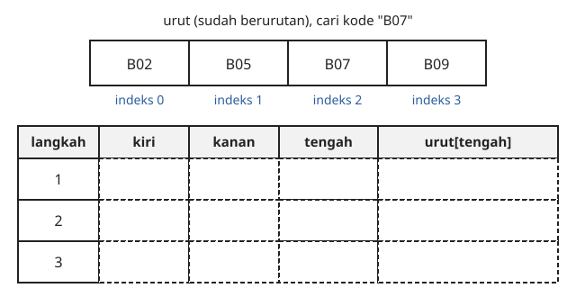

**Ingat dulu:** Tanpa melihat catatan, jawab singkat.

1. Apa beda kondisi dan pengulangan, dan mengapa pekerjaan yang berulang dipindahkan ke subrutin (fungsi)? ______
2. Apa yang dicatat satu *commit* Git, dan mengapa berkas rahasia tidak boleh ikut? ______
3. Apa yang Anda lakukan sebelum menempel teks ke asisten AI? ______



`[Gambar: empat sel berurutan berisi "B02", "B05", "B07", "B09" dengan indeks 0 sampai 3 di bawahnya. Di bawahnya tabel penelusuran pencarian biner untuk kode "B07" dengan kolom langkah, kiri, kanan, tengah, dan urut[tengah], tiga baris kosong. Kerjakan: isi tabel sampai kode ditemukan.]`

**Prediksi:** Sebelum menjalankan apa pun, tulis hasil empat baris `print` ini.

```python
barang = ["B02", "B05", "B02", "B09"]
print(len(barang), len(set(barang)))
stok = {"B02": 0, "B05": 7}
print(stok.get("B09"), stok.get("B09", -1))
print(sorted(barang, reverse=True))
print("B05" in set(barang))
```

Baris 1: ______  Baris 2: ______  Baris 3: ______  Baris 4: ______

**Lengkapi:** Lengkapi tanda perbandingan pada pencarian biner.

```python setengah-jadi
def cari_biner(urut, kode):
    kiri, kanan = 0, len(urut) - 1
    langkah = 0
    while kiri <= kanan:
        langkah += 1
        tengah = (kiri + kanan) // 2
        if urut[tengah] == kode:
            return tengah, langkah
        if urut[tengah] ___ kode:
            kiri = tengah + 1
        else:
            kanan = tengah - 1
    return None, langkah
```

Bila Anda salah menulis `>`, apa yang terjadi pada `cari_biner(kecil, "B07")`? ______

**Latihan:** Data untuk soal 1 sampai 3.

| kode | barang | stok | kategori |
| --- | --- | --- | --- |
| B07 | Kabel contoh | 12 | listrik |
| B02 | Baterai contoh | 0 | listrik |
| B05 | Lampu contoh | 7 | listrik |
| B11 | Kertas contoh | 30 | alat tulis |
| B09 | Pensil contoh | 7 | alat tulis |

1. Urutkan menurun menurut `nama`. Tulis dulu urutan kodenya: ______
2. Tulis `stok_per_kategori(daftar)` yang mengembalikan kamus jumlah stok per kategori, memakai `.get`. Sertakan satu `assert` untuk daftar kosong. ______
3. Tulis subrutin `stok_menipis(daftar, batas)` yang mengembalikan kode barang dengan stok di bawah `batas`, dengan satu kondisi di dalam satu pengulangan. Tulis dulu hasilnya untuk `batas = 8`: ______
4. Jelaskan mengapa pencarian biner pada daftar yang belum diurutkan bisa salah menyatakan "tidak ada". Beri satu contoh kecil. ______

**Cek diri:**

- [ ] Saya tahu kapan kamus lebih tepat daripada daftar.
- [ ] Saya tahu mengapa `sorted(..., key=...)` dikatakan stabil dan mengapa itu berguna.
- [ ] Saya dapat menjelaskan, secara kasar, bagaimana langkah pencarian linear dan biner tumbuh ketika data menjadi 1000 kali lebih banyak.

**Catatan cetak (untuk fasilitator, tidak dicetak):** satu lembar per peserta, dua halaman A4. Kunci ada di modul `dw-pro-m3`, bagian "Kunci dan petunjuk". Lembar tidak memuat kolom nama, tanggal, atau nilai; pencatatan diurus fasilitator.
