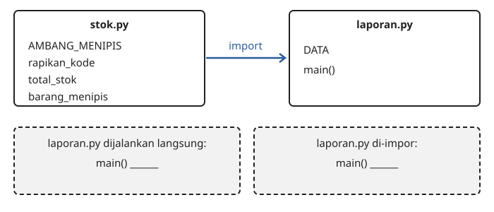

**Ingat dulu:** Tanpa melihat catatan, jawab singkat.

1. Kapan kamus lebih tepat daripada daftar, dan apa syarat pencarian biner? ______
2. Apa guna subrutin, dan apa beda parameter dengan argumen? ______
3. Apa pesan *commit* yang baik, dan mengapa perubahan kecil lebih mudah ditinjau? ______



`[Gambar: dua kotak berkas. Kotak "stok.py" memuat AMBANG_MENIPIS, rapikan_kode, total_stok, dan barang_menipis. Kotak "laporan.py" memuat DATA dan main(). Panah berlabel "import" menuju laporan.py. Di bawahnya dua kotak kosong: "laporan.py dijalankan langsung: main() ___" dan "laporan.py di-impor: main() ___". Kerjakan: isi kedua kotak.]`

**Prediksi:** Skrip di bawah menghitung hal yang sama tiga kali dengan nama satu huruf. Sebelum membaca contoh, tulis (a) apa yang dicetak, (b) tiga hal yang akan Anda ubah agar orang lain bisa membacanya.

```python
d = [(" b07 ", "Kabel contoh", 12), ("B02", "Baterai contoh", 0), ("B05", "Lampu contoh", 3)]
t = 0
for x in d:
    t = t + x[2]
print("Total stok:", t)
m = []
for x in d:
    if x[2] < 5:
        m.append(x[0].strip().upper())
print("Menipis:", sorted(m))
```

(a) ______

(b) ______

**Lengkapi:** Lengkapi nilai yang diharapkan di docstring dan penyebut pembagian.

```python setengah-jadi
def rata_rata_stok(daftar):
    """Kembalikan rata-rata stok; daftar kosong menghasilkan 0.

    >>> rata_rata_stok([{"stok": 2}, {"stok": 4}])
    ___
    >>> rata_rata_stok([])
    0
    """
    if not daftar:
        return 0
    return total_stok(daftar) / ___
```

Apa yang terjadi bila baris `if not daftar:` dihapus dan daftarnya kosong? ______

**Latihan:**

1. Ubah `AMBANG_MENIPIS` menjadi 3. Tulis dulu apa yang dicetak bagian "Menipis" di `laporan.py`. Apakah doctest di `stok.py` masih lolos, dan mengapa? ______
2. Tulis ulang potongan berikut mengikuti PEP 8 dan sebut lima yang Anda ubah. ______

```text
def Hitung(X,y):
  hasil=X+y
  return hasil
```

3. Tulis `kategori_stok(stok)` dengan kondisi `"habis"`, `"menipis"`, dan `"aman"`, lalu sebut satu nilai batas yang menurut Anda perlu diuji. ______

**Cek diri:**

- [ ] Saya dapat menyebut tiga perbaikan dari skrip berantakan ke modul.
- [ ] Saya tahu apa yang dicetak bila `stok.py` di-*impor* dan bila dijalankan langsung.
- [ ] Saya tahu mengapa contoh di docstring ikut diuji.

**Catatan cetak (untuk fasilitator, tidak dicetak):** satu lembar per peserta, dua halaman A4. Kunci ada di modul `dw-pro-m4`, bagian "Kunci dan petunjuk". Lembar tidak memuat kolom nama, tanggal, atau nilai; pencatatan diurus fasilitator.
