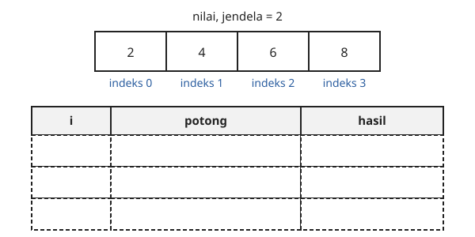

**Ingat dulu:** Tanpa melihat catatan, jawab singkat.

1. Apa guna `if __name__ == "__main__":`, dan bagaimana contoh docstring diuji? ______
2. Apa beda galat sintaks dan galat saat program berjalan? Beri satu contoh masing-masing. ______
3. Mengapa keluaran asisten AI harus diperiksa sebelum dipakai? ______



`[Gambar: empat sel berisi 2, 4, 6, 8 dengan indeks 0 sampai 3, dan tulisan "jendela = 2". Di bawahnya tabel penelusuran dengan kolom i, potong, dan hasil, tiga baris kosong. Kerjakan: telusuri kode pada soal Prediksi dan isi tabel.]`

**Prediksi:** Fungsi ini seharusnya mengembalikan rata-rata tiap dua nilai berurutan. Telusuri dengan tabel, lalu tulis hasil `rata_rata_bergerak([2, 4, 6, 8], 2)` yang Anda harapkan dan hasil yang menurut Anda dikembalikan kode ini.

```python
def rata_rata_bergerak(nilai, jendela):
    hasil = []
    for i in range(len(nilai) - jendela):
        potong = nilai[i : i + jendela]
        hasil.append(sum(potong) / jendela)
    return hasil
```

Diharapkan: ______  Dikembalikan: ______

**Lengkapi:** Lengkapi dua nama metode `unittest`.

```python setengah-jadi
class UjiRataRataBergerak(unittest.TestCase):
    def test_jendela_tidak_valid(self):
        with self.___(ValueError):
            rata_rata_bergerak([1, 2], 0)

    def test_kasus_biasa(self):
        self.___(rata_rata_bergerak([2, 4, 6, 8], 2), [3.0, 5.0, 7.0])
```

Bila Anda memakai `assertTrue` pada bagian kedua dengan daftar tak kosong, apakah uji bisa menangkap hasil yang salah? ______

**Susun:** Beri nomor 1 sampai 6 menurut urutan enam langkah menelusuri galat.

| Nomor | Langkah |
| --- | --- |
| ______ | A. Buktikan: cetak nilai antara atau pakai `pdb` untuk menguji dugaan. |
| ______ | B. Jaga: tambahkan uji yang gagal sebelum perbaikan dan lolos sesudahnya. |
| ______ | C. Hipotesis: tulis satu dugaan penyebab, bukan lima. |
| ______ | D. Reproduksi: temukan masukan terkecil yang membuat galatnya muncul. |
| ______ | E. Perbaiki satu hal. |
| ______ | F. Perkecil: buang apa yang tidak perlu. |

**Latihan:** Baca *traceback* dari bawah.

```text
Traceback (most recent call last):
  File "harga.py", line 8, in <module>
    print(harga_total({"B02": 2, "B99": 1}, {"B02": 1500, "B05": 2000}))
  File "harga.py", line 4, in harga_total
    total += daftar_harga[kode] * jumlah
KeyError: 'B99'
```

1. Hapus `+ 1` dari kode `rata_rata_bergerak` yang sudah benar (penjaga tetap). Tulis dulu uji mana yang gagal dan berapa jumlahnya. ______
2. Pada *traceback* di atas, tulis hipotesis, cara membuktikannya, dan satu uji yang menjaga perbaikannya. Kebijakan perbaikannya Anda putuskan dan alasankan. ______
3. Tulis uji unit untuk `cari_biner` pada daftar kosong, satu elemen, kedua ujung, dan nilai yang tidak ada. ______

**Cek diri:**

- [ ] Saya dapat menelusuri program pendek dengan tabel nilai variabel.
- [ ] Saya dapat menulis satu uji yang gagal bila kode salah.
- [ ] Saya dapat menjelaskan kode dengan kata sendiri, baris demi baris.

**Catatan cetak (untuk fasilitator, tidak dicetak):** satu lembar per peserta, dua halaman A4. Kunci ada di modul `dw-pro-m5`, bagian "Kunci dan petunjuk". Lembar tidak memuat kolom nama, tanggal, atau nilai; pencatatan diurus fasilitator.
