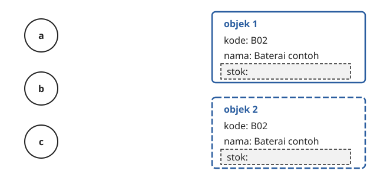

**Ingat dulu:** Tanpa melihat catatan, jawab singkat.

1. Urutkan: spesifikasi, uji, draf AI, tinjauan, catatan asal. Apa yang diperiksa pada tinjauan? ______
2. Apa isi docstring yang membantu orang lain, dan bagaimana contoh di dalamnya diuji? ______
3. Apa yang Anda lakukan sebelum menempel teks ke asisten AI? ______



`[Gambar: di kiri tiga lingkaran bernama a, b, dan c. Di kanan dua kotak objek bernama "objek 1" dan "objek 2", masing-masing berisi kode B02, nama Baterai contoh, dan stok yang kosong. Kerjakan: gambar anak panah dari tiap nama ke objeknya, lalu isi stok tiap objek.]`

**Prediksi:** Kelas `Barang(kode, nama, stok=0)` punya metode `masuk(n)` yang menambah stok. Sebelum menjalankan, gambar panah pada gambar dan tulis hasil dua `print`:

```python
a = Barang("B02", "Baterai contoh", 5)
b = a
b.masuk(3)
print(a.stok, b.stok, a is b)
c = Barang("B02", "Baterai contoh", 5)
print(c == a, c.stok)
```

Baris 1: ______  Baris 2: ______

**Lengkapi:** Lengkapi satu kata kunci pada `Gudang`.

```python setengah-jadi
class Gudang:
    def __init__(self):
        self._barang = {}

    def tambah_barang(self, barang):
        if barang.kode ___ self._barang:
            raise ValueError("kode sudah ada")
        self._barang[barang.kode] = barang
```

Uji mana yang gagal bila Anda menghapus seluruh blok `if`? ______

**Latihan:**

1. Tulis lebih dulu uji untuk kelas `Pesanan`: `tambah(kode, jumlah)` menggabung kode sama dan menolak jumlah nol atau negatif; `total(daftar_harga)` menjumlahkan harga kali jumlah; kode yang tidak ada di `daftar_harga` memunculkan `KeyError`. Lalu tulis kelasnya. ______
2. Mengapa `stok` hanya properti baca? Apa yang bisa salah bila `b.stok = -5` diizinkan, dan apa yang ditentukan `__repr__`? ______
3. Isi lembar keputusan pustaka (lima butir mengidentifikasi pustaka) untuk kebutuhan "membaca tanggal dari teks". Putuskan apakah pustaka bawaan cukup dan catat alasannya. ______
4. Sebuah uji `Gudang` gagal dengan `KeyError`. Tulis enam langkah penelusuran Anda secara singkat. ______

**Cek diri:**

- [ ] Saya dapat menjelaskan beda kelas dan objek, dan apa yang dijaga metode.
- [ ] Saya dapat menjelaskan mengapa `c == a` bernilai `False` pada soal Prediksi.
- [ ] Saya dapat menyebut lima butir mengidentifikasi pustaka.

**Catatan cetak (untuk fasilitator, tidak dicetak):** satu lembar per peserta, dua halaman A4. Kunci ada di modul `dw-pro-m6`, bagian "Kunci dan petunjuk". Lembar tidak memuat kolom nama, tanggal, atau nilai; pencatatan diurus fasilitator.
