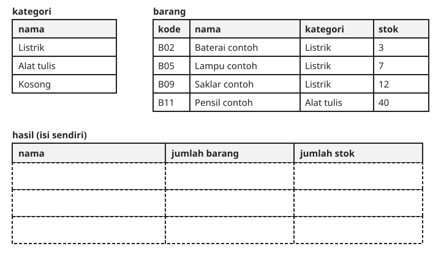

**Ingat dulu:** Tanpa melihat catatan, jawab singkat.

1. Mengapa keadaan objek diubah hanya lewat metode yang menolak nilai tidak valid, dan apa akibat `b = a` pada dua nama untuk satu objek? ______
2. Kapan Anda memilih kamus berkunci dibanding daftar untuk mencari data? ______
3. Di mana kata sandi dan kunci API tidak boleh berada? ______



`[Gambar: tabel "kategori" berisi Listrik, Alat tulis, dan Kosong. Tabel "barang" berisi B02 Baterai contoh (Listrik, stok 3), B05 Lampu contoh (Listrik, 7), B09 Saklar contoh (Listrik, 12), dan B11 Pensil contoh (Alat tulis, 40). Di bawahnya tabel "hasil" dengan kolom nama, jumlah barang, dan jumlah stok, serta tiga baris kosong. Kerjakan: isi tabel hasil.]`

**Prediksi:** Tabel `kategori` berisi `Listrik`, `Alat tulis`, dan `Kosong` (tanpa barang), dan tabel `barang` seperti pada gambar. Sebelum membaca hasilnya, isi tabel hasil untuk kueri ini, lalu jawab.

```sql
SELECT k.nama, COUNT(b.kode), COALESCE(SUM(b.stok), 0)
FROM kategori k
LEFT JOIN barang b ON b.kategori_id = k.id
GROUP BY k.id
ORDER BY k.nama;
```

Jumlah baris yang dikembalikan: ______  Isi baris `Kosong`: ______

Jumlah baris bila `LEFT JOIN` diganti `JOIN`: ______

**Lengkapi:** Lengkapi fungsi `keluarkan` di `gudang_db.py`.

```python setengah-jadi
def keluarkan(conn, kode, jumlah):
    if jumlah <= 0:
        raise ValueError("jumlah harus positif")
    with conn:
        cur = conn.execute(
            "UPDATE barang SET stok = stok - ? WHERE kode = ? AND stok ___ ?",
            (jumlah, kode, jumlah),
        )
        if cur.rowcount ___ 0:
            raise ValueError("kode tidak ada atau stok tidak cukup")
```

Berapa stok `B02` bila Anda menulis `>` pada lubang pertama dan meminta 3 dari stok 3? ______

**Latihan:**

1. Tambahkan kolom `harga INTEGER NOT NULL CHECK (harga >= 0)` dengan cara yang tidak menghapus data (`ALTER TABLE ... ADD COLUMN ... DEFAULT 0`), lalu tulis kueri nilai stok per kategori (`SUM(stok * harga)`). ______
2. Rancang tabel `mutasi` (kode barang, jumlah, jenis `masuk` atau `keluar`, waktu) dengan kunci asing dan batasan `CHECK`; gambar relasinya sebagai tiga baris teks. ______
3. Mengapa `ringkas_kategori` memakai `LEFT JOIN`? Mengapa `PRAGMA foreign_keys` harus diulang di tiap koneksi? ______
4. Uji `test_kategori_tidak_ada_ditolak` gagal karena tidak ada galat. Tulis enam langkah penelusuran dan sebut baris pertama yang Anda curigai. ______

**Cek diri:**

- [ ] Saya dapat menjelaskan mengapa aturan stok tidak negatif ditaruh di skema, bukan hanya di kode.
- [ ] Saya tahu apa yang dijamin `with conn:`.
- [ ] Saya dapat memilih antara `JOIN` dan `LEFT JOIN` untuk daftar "semua kategori beserta jumlah barangnya".

**Catatan cetak (untuk fasilitator, tidak dicetak):** satu lembar per peserta, dua halaman A4. Kunci ada di modul `dw-pro-m7`, bagian "Kunci dan petunjuk". Lembar tidak memuat kolom nama, tanggal, atau nilai; pencatatan diurus fasilitator.
