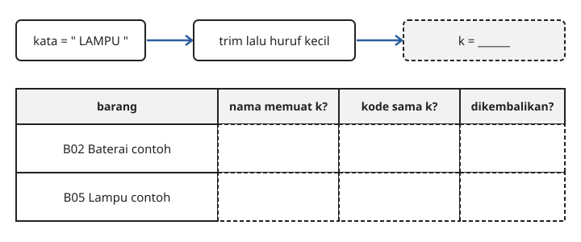

**Ingat dulu:** Tanpa melihat catatan, jawab singkat.

1. Mengapa nilai dititipkan ke kueri lewat `?`, dan apa yang terjadi bila disambung ke teks SQL? ______
2. Apa beda uji yang gagal dan uji yang *error*, dan dari mana Anda mulai membaca *traceback*? ______
3. Apa yang dilakukan `.gitignore` terhadap berkas yang sudah pernah di-commit? ______



`[Gambar: kotak masukan berisi kata "  LAMPU ", panah ke kotak "trim lalu huruf kecil", panah ke kotak kosong "k = ___". Di bawahnya tabel dua baris: B02 Baterai contoh dan B05 Lampu contoh, dengan kolom kosong "nama memuat k?", "kode sama dengan k?", dan "dikembalikan?". Kerjakan: isi semua kotak kosong.]`

**Prediksi:** Dengan fungsi di bawah, isi gambar, lalu tulis dua prediksi. Pertama, kode barang yang dikembalikan `saring(DATA, "  LAMPU ")` pada daftar `B02` (Baterai contoh) dan `B05` (Lampu contoh). Kedua, bila nama sebuah barang berisi teks `` dan dipasang lewat `barisTabel`, apakah sebuah gambar muncul di halaman?

```ts
export type Barang = { kode: string; nama: string; kategori: string; stok: number };

export function saring(daftar: Barang[], kata: string): Barang[] {
  const k = kata.trim().toLowerCase();
  if (k === "") return daftar;
  return daftar.filter((b) => b.nama.toLowerCase().includes(k) || b.kode.toLowerCase() === k);
}

export function esc(teks: string): string {
  return teks
    .replace(/&/g, "&amp;")
    .replace(/</g, "&lt;")
    .replace(/>/g, "&gt;")
    .replace(/"/g, "&quot;");
}

export function barisTabel(b: Barang): string {
  const kelas = b.stok < 5 ? ' class="menipis"' : "";
  return `<tr${kelas}><td>${esc(b.kode)}</td><td>${esc(b.nama)}</td><td>${esc(b.kategori)}</td><td class="angka">${b.stok}</td></tr>`;
}
```

Kode yang dikembalikan: ______  Gambar muncul? ______

**Lengkapi:** Lengkapi fungsi `esc` agar tanda kutip tunggal juga dinetralkan, lalu tambahkan ujinya.

```ts setengah-jadi
export function esc(teks: string): string {
  return teks
    .replace(/&/g, "&amp;")
    .replace(/</g, "&lt;")
    .replace(/>/g, "&gt;")
    .replace(/"/g, "&quot;")
    .replace(/___/g, "&#39;");
}
```

Mengapa `&` harus diganti paling awal? ______

**Latihan:**

1. Ubah ambang `menipis` menjadi 8. Ubah ujinya lebih dulu, lihat gagal, baru ubah kode. ______
2. Jelaskan mengapa `esc` dipakai, padahal datanya milik Anda sendiri. Apa yang berubah bila data kelak datang dari pengguna lain? ______
3. Rancang tabel SQL untuk data halaman ini, lalu tulis kueri yang mengembalikan kode, nama, kategori, dan stok terurut menurut kode. ______
4. Uji `kode cocok persis` gagal karena `saring(DATA, "b02")` mengembalikan daftar kosong. Tulis enam langkah penelusuran dan sebut baris yang Anda curigai. ______

**Cek diri:**

- [ ] Saya dapat menjelaskan apa yang dilakukan `esc` dan mengapa `&` diganti pertama.
- [ ] Saya tahu apa yang membuat tabel tetap terpakai pada layar 360 piksel.
- [ ] Saya tahu mengapa `saring` diuji dengan kata berspasi dan huruf besar.

**Catatan cetak (untuk fasilitator, tidak dicetak):** satu lembar per peserta, dua halaman A4. Kunci ada di modul `dw-pro-m8`, bagian "Kunci dan petunjuk". Lembar tidak memuat kolom nama, tanggal, atau nilai; pencatatan diurus fasilitator.
