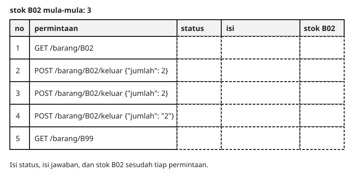

**Ingat dulu:** Tanpa melihat catatan, jawab singkat.

1. Mengapa teks dari data dinetralkan sebelum dipasang ke halaman? ______
2. Sebutkan lima butir mengidentifikasi pustaka sebelum memakainya, dan kapan pustaka bawaan sudah cukup. ______
3. Bagaimana Anda membandingkan dua solusi tanpa stopwatch? ______



`[Gambar: tabel lima baris berisi permintaan berurutan (GET /barang/B02; POST /barang/B02/keluar dengan jumlah 2; permintaan yang sama sekali lagi; POST dengan jumlah "2" sebagai teks; GET /barang/B99) dan tiga kolom kosong: kode status, isi, dan stok B02 sesudahnya. Stok B02 mula-mula 3.]`

**Prediksi:** Spesifikasi layanan: `GET /barang/<kode>` mengembalikan satu barang atau 404; `POST /barang/<kode>/keluar` dengan badan JSON `{"jumlah": n}` mengurangi stok. Jumlah harus bilangan bulat positif (kalau tidak, 400), barang yang tidak ada 404, stok yang kurang 409 (benturan dengan keadaan sekarang). Stok `B02` adalah 3. Isi tabel pada gambar: pasangan (kode status, isi) untuk tiap permintaan.

**Lengkapi:** Lengkapi pemuat konfigurasi.

```python setengah-jadi
def muat_konfigurasi(path):
    with open(path, "___") as berkas:
        return tomllib.___(berkas)
```

Apa pesan galat bila lubang pertama diisi `"r"`? ______

**Latihan:**

1. Sebuah tim memilih `422` untuk stok kurang. Ubah ujinya lebih dulu, lihat gagal, baru ubah kode, lalu tulis satu kalimat tentang kode mana yang Anda pilih dan mengapa. ______
2. Tambahkan `[server] batas_badan = 1024` ke konfigurasi dan pakai nilainya dari berkas, bukan dari konstanta. Tulis perubahannya. ______
3. Mengapa `type(jumlah) is not int` dipakai, padahal `True` juga dianggap bilangan bulat oleh `isinstance`? Mengapa alamat dicocokkan dengan pola, bukan langsung dipakai? ______
4. Rancang `fetch` dari `stok.ts` ke `GET /barang`; apa yang dilakukan halaman bila status bukan 200? ______
5. Mengapa `keluarkan` memeriksa stok di dalam `UPDATE`, dan apa akibatnya pada dua permintaan `POST` yang datang bersamaan? ______

**Cek diri:**

- [ ] Saya dapat menjelaskan mengapa stok kurang diberi `409`, bukan `400`.
- [ ] Saya dapat menjelaskan apa yang dicegah pola alamat dan batas ukuran badan.
- [ ] Saya tahu akibatnya bila alamat layanan `0.0.0.0` dan isian belum diperiksa.

**Catatan cetak (untuk fasilitator, tidak dicetak):** satu lembar per peserta, dua halaman A4. Kunci ada di modul `dw-pro-m9`, bagian "Kunci dan petunjuk". Lembar tidak memuat kolom nama, tanggal, atau nilai; pencatatan diurus fasilitator.
