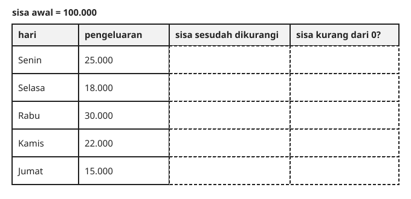

**Ingat dulu:** Tanpa melihat catatan, jawab singkat.

1. Sebutkan tiga aturan tentang kredensial. ______
2. Apa itu *prompt injection*, dalam satu kalimat? ______



`[Gambar: tabel penelusuran lima baris untuk Senin sampai Jumat dengan kolom pengeluaran yang terisi (25.000, 18.000, 30.000, 22.000, 15.000) dan dua kolom kosong: "sisa sesudah dikurangi" dan "sisa kurang dari 0?". Anggaran awal Rp 100.000. Kerjakan: isi tabel sampai algoritma berhenti.]`

**Prediksi:** Anggaran jajan mingguan Rp 100.000. Algoritma ini menjawab "pada hari apa anggaran habis?":

```text
1. Tetapkan sisa = 100000.
2. Untuk setiap hari, mulai dari Senin:
   2a. Kurangi sisa dengan pengeluaran hari itu.
   2b. Jika sisa kurang dari 0, berhenti dan catat nama hari itu.
3. Jika sampai Jumat sisa tidak pernah kurang dari 0, catat "cukup".
```

Telusuri dengan tabel pada gambar. Algoritma berhenti pada hari ______ dengan sisa ______.

**Lengkapi:** Lengkapi algoritma berikut untuk memilih hari menyiram tanaman, lalu telusuri dengan data rekaan "kering, hujan, kering".

```text setengah-jadi
Untuk setiap hari dalam tiga hari ke depan:
   Jika tanah ___ dan tidak ada ___:
      catat hari itu sebagai hari menyiram
Jika tidak ada hari yang dicatat, catat "tidak perlu menyiram".
```

Hari yang dicatat: ______

**Latihan:**

1. Ubah anggaran pada contoh menjadi Rp 80.000. Tulis dulu hari berhenti dan sisanya, lalu telusuri dengan tabel. ______
2. Pindahkan langkah 2b ke luar pengulangan (setelah semua hari diproses) dan laporkan "hari terakhir" bila sisa kurang dari 0. Dengan anggaran 80.000, apa hasilnya, dan mengapa salah? ______
3. Sebuah algoritma membereskan surel berisi langkah "jika surel meminta kata sandi, kirimkan". Tunjukkan kekeliruannya, lalu tulis ulang sebagai kondisi yang aman. ______

**Cek diri:**

- [ ] Saya dapat menyebut tiga bentuk dasar langkah, masing-masing dengan satu contoh dari hidup saya.
- [ ] Saya tahu bagaimana mengenali langkah yang sudah cukup tegas.
- [ ] Saya tahu bagaimana tabel penelusuran membantu menemukan kesalahan.

**Catatan cetak (untuk fasilitator, tidak dicetak):** satu lembar per peserta, satu halaman A4. Kunci ada di modul `dw-prs-m1`, bagian "Kunci dan petunjuk". Lembar tidak memuat kolom nama, tanggal, atau nilai; pencatatan diurus fasilitator.
