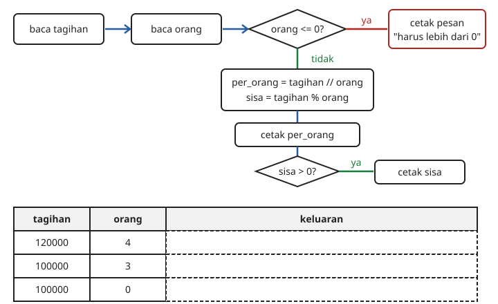

**Ingat dulu:** Tanpa melihat catatan, jawab singkat.

1. Apa itu kondisi dan pengulangan? Beri satu contoh sehari-hari untuk masing-masing. ______
2. Mengapa langkah "pastikan semuanya beres" belum bisa dijalankan tanpa menebak? ______
3. Sebutkan tiga aturan tentang kredensial. ______



`[Gambar: diagram alir kalkulator patungan: baca tagihan, baca jumlah orang, lalu kotak keputusan "orang <= 0?". Bila ya: cetak "Jumlah orang harus lebih dari 0.". Bila tidak: per_orang = tagihan // orang dan sisa = tagihan % orang, cetak per_orang, lalu keputusan "sisa > 0?" yang bila ya mencetak sisa. Di bawahnya tabel tiga masukan (120000 dan 4; 100000 dan 3; 100000 dan 0) dengan kolom keluaran kosong. Kerjakan: telusuri diagram dan isi keluaran.]`

**Prediksi:** Sebelum menjalankan, tulis: apa yang terjadi bila potongan ini dijalankan dan pengguna mengetik `30`?

```python
umur = input()
print(umur + 1)
```

______

**Lengkapi:** Lengkapi tiga titik agar program menghitung rata-rata nilai.

```python setengah-jadi
nilai = [70, 80, 90]
total = 0
for n in ___:
    total ___ n
print("Rata-rata:", total / ___)
```

Keluaran program: ______

**Latihan:**

1. Tulis `suhu.py`: baca suhu Celsius sebagai bilangan bulat dan cetak suhu Fahrenheit dengan rumus `c * 9 / 5 + 32`. Tulis dulu hasil untuk 20 dan 100. ______
2. Apa yang terjadi pada `suhu.py` bila pengguna mengetik `abc`? Tulis satu cara sederhana menanganinya pada tahap ini (misalnya mengingatkan pengguna di teks permintaan). ______
3. Teman menyarankan menaruh kata sandi surel di dalam program kalkulator supaya "praktis". Tunjukkan dua risikonya. ______

**Cek diri:**

- [ ] Saya dapat menjelaskan mengapa `int(input())`, bukan `input()` saja, dipakai untuk hitungan.
- [ ] Saya tahu bagaimana mengetahui bahwa perulangan `while` akan berhenti.
- [ ] Saya dapat menyebut satu masukan tepi untuk kalkulator patungan dan hasil yang benar.

**Catatan cetak (untuk fasilitator, tidak dicetak):** satu lembar per peserta, satu sampai dua halaman A4. Kunci ada di modul `dw-prs-m2`, bagian "Kunci dan petunjuk". Lembar tidak memuat kolom nama, tanggal, atau nilai; pencatatan diurus fasilitator.
