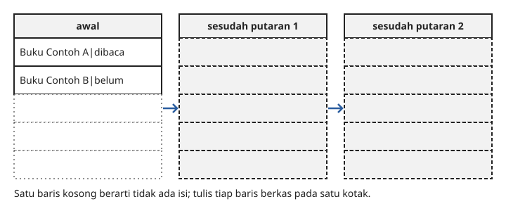

**Ingat dulu:** Tanpa melihat catatan, jawab singkat.

1. Mengapa `input()` perlu dibungkus `int(...)` sebelum dihitung, dan apa yang terjadi bila lupa? ______
2. Apa ciri langkah yang tegas, dan apa contoh langkah yang samar? ______
3. Mengapa keluaran asisten AI diperlakukan sebagai draf? ______



`[Gambar: tiga kolom isi berkas daftar_bacaan.txt. Kolom "awal" berisi dua baris: "Buku Contoh A|dibaca" dan "Buku Contoh B|belum". Kolom "sesudah putaran 1" dan "sesudah putaran 2" kosong, masing-masing dengan lima baris kosong. Kerjakan: isi kedua kolom kosong.]`

**Prediksi:** Berkas `daftar_bacaan.txt` berisi dua baris `Buku Contoh A|dibaca` dan `Buku Contoh B|belum`. Sebuah program membaca berkas itu, menambah satu entri `Buku Contoh C|belum` tanpa memeriksa apakah sudah ada, menandai Buku Contoh B sebagai `dibaca`, lalu menyimpan seluruh daftar. Isi kolom pada gambar. Bila program dijalankan **dua kali berturut-turut**, isi daftar sesudah putaran kedua: ______

**Lengkapi:** Lengkapi empat titik pada fungsi penghitung status.

```python setengah-jadi
def hitung_status(daftar, status):
    jumlah = 0
    for entri in daftar:
        if entri[___] == ___:
            jumlah ___ 1
    return jumlah
```

Dengan tiga entri (A dan B `dibaca`, C `belum`), `hitung_status(daftar, "dibaca")` memberi: ______

**Latihan:**

1. Ubah program agar tidak menambah judul yang sudah ada. Tulis dulu isi daftar sesudah putaran kedua dengan perubahan Anda. ______
2. Cetak ringkasan di akhir, misalnya `2 dari 3 sudah dibaca`, memakai `hitung_status` dan `len`. ______
3. Mengapa `muat` menangkap `FileNotFoundError`, dan apa yang terjadi pada putaran pertama bila berkas belum ada dan tangkapan itu dihapus? ______
4. Tulis algoritma lima langkah dalam bahasa sehari-hari untuk "menandai buku sebagai dibaca", lalu cocokkan satu per satu dengan baris program Anda. ______

**Cek diri:**

- [ ] Saya dapat menulis dari ingatan fungsi `simpan(nama_berkas, daftar)` untuk daftar kamus berkunci `judul` dan `status`.
- [ ] Saya tahu kapan memakai daftar dan kapan kamus.
- [ ] Saya tahu risiko membuka berkas dengan `"w"`.

**Catatan cetak (untuk fasilitator, tidak dicetak):** satu lembar per peserta, dua halaman A4. Kunci ada di modul `dw-prs-m3`, bagian "Kunci dan petunjuk". Lembar tidak memuat kolom nama, tanggal, atau nilai; pencatatan diurus fasilitator.
