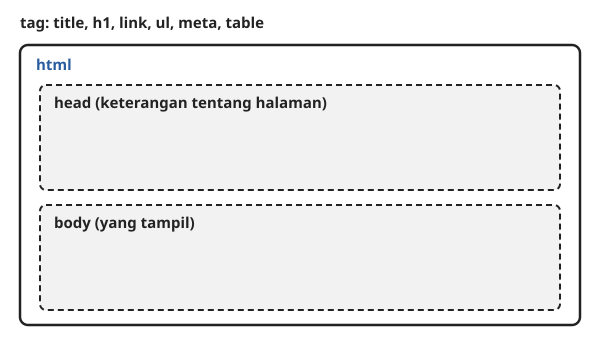

**Ingat dulu:** Tanpa melihat catatan, jawab singkat.

1. Apa beda mode `"w"` dan `"a"`, dan mengapa program yang menulis berkas perlu aman dijalankan dua kali? ______
2. Mengapa `input()` perlu dibungkus `int(...)`? ______
3. Apa itu menelusuri dengan tabel, dan mengapa dikerjakan sebelum langkah dianggap benar? ______



`[Gambar: kerangka halaman HTML berupa kotak besar "html" yang berisi dua kotak kosong, "head" dan "body". Di atasnya daftar enam tag: title, h1, link, ul, meta, table. Kerjakan: tulis tiap tag ke kotak head atau body yang benar.]`

**Prediksi:** Sebelum membaca, tulis apa yang tampil di peramban untuk potongan ini.

```html
<ul><li>Cabai</li><li>Kemangi</li></ul>
<p>Saya menanam <strong>cabai</strong> di balkon.</p>
```

Berapa butir daftar: ______  Kata yang tebal: ______

**Lengkapi:** Lengkapi tiga titik agar tampil subjudul "Jadwal pupuk" dan tautan yang bisa diklik.

```html setengah-jadi
<___>Jadwal pupuk</___>
<p><a ___="https://developer.mozilla.org/en-US/docs/Web/CSS">Belajar CSS</a></p>
```

Apa yang tampil jika Anda salah menulis nama atributnya? ______

**Latihan:**

1. Ganti warna `h1` menjadi warna lain yang tetap mudah dibaca dan tambahkan satu tanaman ke daftar. Tulis dulu apa yang berubah di tampilan. ______
2. Ubah `href="gaya.css"` menjadi `href="gayaa.css"`. Apa yang terlihat, dan mengapa halaman tetap tampil walau tanpa gaya? ______
3. Tulis program Python yang menghasilkan teks `<ul>` dengan satu `<li>` untuk tiap nama dalam daftar `["Cabai rawit", "Kemangi", "Seledri & daun bawang"]`. Tulis dulu bagaimana tanda `&` seharusnya ditulis dalam HTML. ______
4. Daftar tiga hal yang tidak Anda taruh di halaman yang kelak bisa dibaca orang lain, dan jelaskan alasannya. ______

**Cek diri:**

- [ ] Saya dapat menulis dari ingatan kerangka halaman HTML dengan `head`, `title`, `body`, dan satu judul.
- [ ] Saya tahu apa yang dilakukan `href` pada `<link>` dan pada `<a>`.
- [ ] Saya tahu beda membuka berkas langsung dan melayaninya dengan `http.server`.

**Catatan cetak (untuk fasilitator, tidak dicetak):** satu lembar per peserta, satu sampai dua halaman A4. Kunci ada di modul `dw-prs-m4`, bagian "Kunci dan petunjuk". Lembar tidak memuat kolom nama, tanggal, atau nilai; pencatatan diurus fasilitator.
