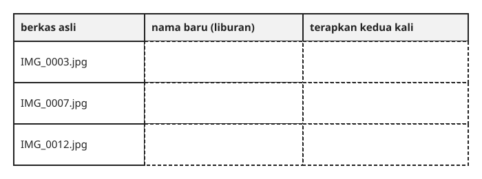

**Ingat dulu:** Tanpa melihat catatan, jawab singkat.

1. Apa beda HTML dan CSS, dan mengapa gaya dipisah ke berkas sendiri? ______
2. Tulis dari ingatan perulangan `for` yang menjumlahkan semua anggota daftar `[70, 80, 90]` dan mencetak rata-ratanya. ______
3. Mengapa `catatan.get("penulis", "tidak ada")` lebih aman daripada `catatan["penulis"]` bila kuncinya mungkin tidak ada? ______



`[Gambar: tabel tiga baris dengan kolom "berkas asli" terisi (IMG_0003.jpg, IMG_0007.jpg, IMG_0012.jpg) dan dua kolom kosong: "nama baru (awalan liburan)" dan "tercetak saat terapkan kedua kali".]`

**Prediksi:** Sebuah folder latihan berisi `IMG_0003.jpg`, `IMG_0007.jpg`, dan `IMG_0012.jpg`. Sebuah skrip menamainya ulang menjadi `liburan-001.jpg` dan seterusnya, berurutan menurut nama berkas. Tanpa kata `--terapkan` skrip hanya mencetak rencana. Isi tabel pada gambar, lalu tulis: (a) nama baru ketiganya, dan (b) apa yang tercetak dan berubah bila perintah terapkan dijalankan **untuk kedua kalinya**.

(a) ______

(b) ______

**Lengkapi:** Lengkapi tiga titik agar program memberi peringatan bila tenggat tinggal tiga hari atau kurang.

```python setengah-jadi
from datetime import date

hari_ini = date(2026, 11, 19)
tenggat = date(2026, 11, 25)
selisih = (___ - ___).days
if selisih ___ 3:
    print("Segera!")
else:
    print("Masih lama:", selisih, "hari")
```

Keluaran program: ______

**Latihan:**

1. Mengapa skrip penamaan mencetak rencana dulu, dan apa yang bisa salah bila langsung menamai ulang? Beri satu contoh kejadian di folder latihan Anda sendiri. ______
2. Simpan jadwal ke berkas teks berbaris `nama|tanggal`, lalu baca kembali (`date.fromisoformat` mengubah teks menjadi tanggal). Mengapa tanggal harus diubah dari teks sebelum dikurangkan? ______
3. Tulis kalkulator kecil yang membaca batas dan pengeluaran dari `input()` dan mencetak `aman` atau `LEBIH`. Tulis dulu hasil untuk batas `150000` dan pengeluaran `170000`. ______

**Cek diri:**

- [ ] Saya dapat menjelaskan mengapa skrip penamaan punya mode uji coba.
- [ ] Saya dapat menulis dari ingatan pola menjumlahkan per kategori dengan kamus.
- [ ] Saya tahu cara menghitung berapa hari lagi sampai suatu tanggal.

**Catatan cetak (untuk fasilitator, tidak dicetak):** satu lembar per peserta, dua halaman A4. Kunci ada di modul `dw-prs-m5`, bagian "Kunci dan petunjuk". Lembar tidak memuat kolom nama, tanggal, atau nilai; pencatatan diurus fasilitator.
