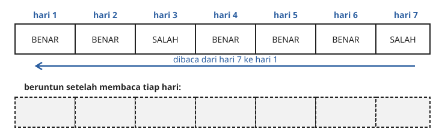

**Ingat dulu:** Tanpa melihat catatan, jawab singkat.

1. Mengapa skrip yang mengubah berkas perlu mode uji coba dan aman dijalankan dua kali? ______
2. Tulis satu masalah pribadi sebagai algoritma lima langkah dengan satu kondisi dan satu pengulangan. ______



`[Gambar: tujuh kotak berurutan untuk hari 1 sampai 7 dengan isi BENAR, BENAR, SALAH, BENAR, BENAR, BENAR, SALAH. Panah di bawahnya bertuliskan "dibaca dari hari 7 ke hari 1". Satu baris kotak kosong berisi hitungan beruntun tiap langkah. Kerjakan: isi baris hitungan.]`

**Prediksi:** Fungsi `hitung_beruntun(catatan)` menghitung banyak hari berturut-turut di **akhir** daftar yang bernilai benar (target tercapai). Isi baris hitungan pada gambar. Untuk daftar pada gambar, berapa hasilnya, dan mengapa? ______

**Lengkapi:** Lengkapi empat titik agar fungsi menghitung persen hari tercapai dan memberi 0 untuk daftar kosong.

```python setengah-jadi
def persen_tercapai(catatan):
    if len(catatan) == ___:
        return 0
    jumlah = sum(1 for t in catatan if ___)
    return jumlah * 100 // ___
```

Hasil untuk daftar pada gambar: ______  Hasil untuk `[]`: ______

**Latihan:**

1. Tulis uji untuk `hitung_beruntun` pada daftar satu anggota (`[True]` dan `[False]`). Tulis dulu hasilnya. ______
2. Isi kartu proyek Anda sendiri dengan data rekaan:

   - Masalah: ______
   - Masukan: ______
   - Keluaran: ______
   - Batas: ______
   - Kasus uji: ______
   - Langkah: ______

3. Tulis penjelasan lima kalimat proyek Anda dan beri tanda satu bagian yang masih Anda ragukan. ______

**Cek diri:**

- [ ] Saya dapat menyebut enam bagian kartu proyek.
- [ ] Saya dapat menjelaskan mengapa `hitung_beruntun([True, True, False])` bernilai 0, bukan 2.
- [ ] Saya tahu apa yang saya lakukan bila tidak dapat menjelaskan satu bagian proyek saya.

**Catatan cetak (untuk fasilitator, tidak dicetak):** satu lembar per peserta, dua halaman A4. Kunci ada di modul `dw-prs-m6`, bagian "Kunci dan petunjuk". Lembar tidak memuat kolom nama, tanggal, atau nilai; pencatatan diurus fasilitator.
