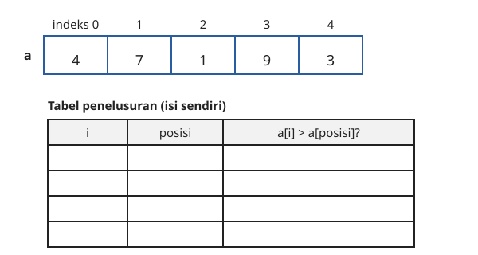

**Ingat dulu:** Tanpa melihat catatan, jawab: (1) berapa indeks elemen terakhir `int a[6]`? (2) mengapa `int f(int x)` yang mengubah `x` tidak mengubah variabel pemanggil?



`[Gambar: larik a dengan lima kotak berindeks 0 sampai 4 berisi 4, 7, 1, 9, 3. Di bawahnya tabel kosong berkolom i, posisi, dan "a[i] > a[posisi]?" dengan empat baris untuk diisi saat menelusuri kode bagian Prediksi.]`

**Prediksi (bagian 3):** Telusuri program ini di tabel pada gambar, lalu tulis keluarannya. Jangan menjalankannya dulu.

```cpp
#include <iostream>
using namespace std;

int main() {
    int a[5] = {4, 7, 1, 9, 3};
    int posisi = 0;
    for (int i = 1; i < 5; i++) {
        if (a[i] > a[posisi]) {
            posisi = i;
        }
    }
    cout << a[0] + a[4] << ' ' << posisi << ' ' << a[posisi] << '\n';
    return 0;
}
```

Keluaranku: ______

**Lengkapi (bagian 1):** Program menghitung ongkos kirim: gratis bila belanja minimal 100000, selain itu 10000. Isi tiga tempat kosong.

```cpp setengah-jadi
int belanja;
cin >> belanja;
int ongkos;
if (belanja ___ 100000) {
    ongkos = ___;
} else {
    ongkos = ___;
}
cout << "Ongkos: " << ongkos << '\n';
```

**Susun (bagian 1):** Susun baris acak ini menjadi program yang mencetak "genap" atau "ganjil" untuk `n = 7`. Tanda kurung kurawal ditambahkan sendiri.

- A. `cout << "ganjil";`
- B. `if (n % 2 == 0)`
- C. `int n = 7;`
- D. `else`
- E. `cout << "genap";`

Urutanku: ______ ______ ______ ______ ______

**Latihan:**

1. (bagian 1) Tulis program yang membaca suhu (`int`) dan mencetak "dingin" (di bawah 20), "sejuk" (20 sampai 29), atau "panas" (30 ke atas).

   ______

2. (bagian 1) Jelaskan mengapa `static_cast<double>(a) / b` dan `double c = a / b` memberi hasil yang berbeda.

   ______

3. (bagian 2) Buat tabel panggilan untuk `fpb(35, 14)`.

   | Panggilan | `a` | `b` | `a % b` | Hasil |
   | --- | --- | --- | --- | --- |
   | 1 | | | | |
   | 2 | | | | |
   | 3 | | | | |
   | 4 | | | | |

4. (bagian 3) Jelaskan mengapa `a[5]` pada `int a[5]` salah dan sering tidak ditolak kompiler.

   ______

5. (bagian 4) Apa yang terjadi bila `new int[n]` tidak pernah dipasangkan dengan `delete[]`?

   ______

**Cek diri:**

- [ ] Aku dapat menelusuri program pendek di kertas.
- [ ] Aku dapat menjelaskan salinan, referensi, dan penunjuk.
- [ ] Aku dapat menulis fungsi dengan kasus tepi.

**Catatan cetak (untuk dosen, tidak dicetak):** sekitar 3 halaman A4. Kunci ada di modul `kul-i-101` bagian "Kunci dan petunjuk". Lembar tidak memuat kolom identitas.
