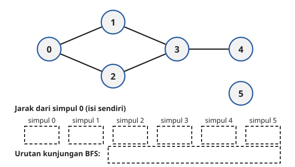

**Ingat dulu:** Tanpa melihat catatan: (1) apa yang dilakukan `*p` dan apa yang dilakukan `&x`? (2) tulis kasus dasar dan langkah rekursif `fpb(a, b)`.



`[Gambar: graf tak berarah dengan simpul 0 sampai 5 dan sisi 0-1, 0-2, 1-3, 2-3, 3-4; simpul 5 sendirian. Di bawahnya satu baris kotak kosong "jarak dari simpul 0" untuk tiap simpul, dan satu kotak kosong untuk urutan kunjungan BFS dari simpul 0.]`

**Prediksi (bagian 1):** Tulis keluaran program ini tanpa menjalankannya.

```cpp
#include <iostream>
#include <queue>
#include <stack>
using namespace std;

int main() {
    stack<int> s;
    queue<int> q;
    for (int i = 1; i <= 4; i++) {
        s.push(i);
        q.push(i);
    }
    s.pop();
    q.pop();
    cout << s.top() << ' ' << q.front() << ' ' << s.size() << ' ' << q.size() << '\n';
    return 0;
}
```

Keluaranku: ______

**Prediksi (bagian 4):** Pada graf di gambar, tetangga ditulis menurut urutan sisi yang dimasukkan. Isi urutan kunjungan BFS dari simpul 0 dan jarak tiap simpul dari 0 (`-1` bila tak terjangkau) langsung pada gambar.

**Lengkapi (bagian 1):** Fungsi yang menghitung panjang daftar.

```cpp setengah-jadi
int panjang(const Simpul *k) {
    int n = 0;
    while (___) {
        n++;
        k = ___;
    }
    return n;
}
```

**Lengkapi (bagian 5):** Pasangkan kebutuhan dengan struktur dan beri satu alasan.

```text
(a) antrian pesanan yang dilayani sesuai urutan datang       -> ______
(b) "apakah kode ini sudah pernah terpakai?" sangat sering   -> ______
(c) selalu ambil tugas dengan prioritas terkecil             -> ______
(d) menelusuri teman-teman dari teman (jaringan relasi)      -> ______
```

**Latihan:**

1. (bagian 3) Fungsi hash `k % 5`. Kunci 12, 7, 22, 5, 17 dimasukkan berurutan. Tulis isi tiap ember dan banyak elemen di ember terpadat.

   | Ember | 0 | 1 | 2 | 3 | 4 |
   | --- | --- | --- | --- | --- | --- |
   | Isi | | | | | |

   Ember terpadat berisi ______ elemen.

2. (bagian 2) Gambarkan BST dari 5, 3, 8, 1, 4, 7 (sisip berurutan, 5 sebagai akar) dan tulis urutan *inorder*.

   ______

3. (bagian 2) Mengapa BST yang disisipi data terurut menjadi lambat?

   ______

4. (bagian 1) Apa beda stack dan queue pada urutan keluar elemen?

   ______

5. (bagian 4) Mengapa BFS memberi jarak terpendek tetapi DFS tidak?

   ______

**Cek diri:**

- [ ] Aku dapat menulis dan menelusuri operasi pada *linked list*.
- [ ] Aku dapat menjelaskan tabrakan hash dan dampaknya.
- [ ] Aku dapat menulis BFS dan DFS dan menjelaskan perbedaannya.

**Catatan cetak (untuk dosen, tidak dicetak):** sekitar 3 halaman A4. Kunci ada di modul `kul-i-102` bagian "Kunci dan petunjuk". Lembar tidak memuat kolom identitas.
