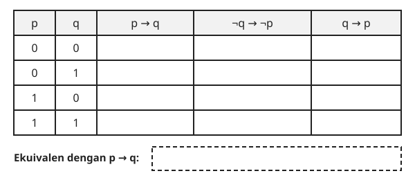

**Ingat dulu:** Tanpa melihat catatan: (1) tulis penyangkal pernyataan "semua bilangan prima ganjil"; (2) apa nilai kebenaran `p → q` bila `p` salah?



`[Gambar: tabel kebenaran dengan kolom p dan q yang sudah berisi empat kombinasi 0 0, 0 1, 1 0, 1 1, lalu tiga kolom kosong berlabel "p → q", "¬q → ¬p", dan "q → p" untuk diisi dengan 0 atau 1. Di bawahnya satu kotak kosong untuk menulis mana yang ekuivalen dengan p → q.]`

**Prediksi (bagian 1):** Isi tabel kebenaran pada gambar tanpa menjalankan program. Lalu tebak: mana yang ekuivalen dengan `p → q`?

**Lengkapi (bagian 3):** Bukti bahwa 1 + 3 + 5 + ... + (2n − 1) = n².

- Pangkal n = 1: ruas kiri ______, ruas kanan ______.
- Langkah: anggap 1 + 3 + ... + (2k − 1) = k². Maka 1 + 3 + ... + (2k − 1) + (2(k+1) − 1) = k² + ______ = (k + 1)².

**Lengkapi (bagian 4):** Pengisian segitiga Pascal dengan syarat batas.

```cpp setengah-jadi
for (int n = 0; n <= 5; n++) {
    c[n][0] = ___;
    for (int k = 1; k <= n; k++) {
        c[n][k] = c[n-1][___] + c[n-1][___];
    }
}
```

**Latihan:**

1. (bagian 2) Pada S = {1, 2, 3}, apakah R = {(1,2), (2,3)} refleksif, simetris, transitif? Beri alasan singkat.

   Refleksif: ______ Simetris: ______ Transitif: ______

2. (bagian 2) Pada {0, ..., 5} definisikan a ~ b bila a mod 2 = b mod 2. Tulis kelas ekuivalennya.

   ______

3. (bagian 4) Berapa kata sandi berpanjang 3 dari huruf A B C D bila (a) boleh mengulang huruf, (b) tidak boleh mengulang? Berapa cara memilih 2 dari 5 orang?

   (a) ______ (b) ______ memilih 2 dari 5: ______

4. (bagian 4) Dengan inklusi-eksklusi, hitung banyak bilangan 1 sampai 200 yang habis dibagi 3 atau 5.

   ______

5. (bagian 5) Graf lima simpul 0 sampai 4 dengan sisi 0-1, 0-2, 1-2, 2-3, 3-4. Isi tabel derajat, lalu hitung jumlahnya.

   | Simpul | 0 | 1 | 2 | 3 | 4 | Jumlah |
   | --- | --- | --- | --- | --- | --- | --- |
   | Derajat | | | | | | |

   Simpul berderajat ganjil: ______ buah.

**Cek diri:**

- [ ] Aku dapat mengisi tabel kebenaran dan memutuskan ekuivalensi.
- [ ] Aku dapat menulis bukti induksi lengkap dengan pangkal dan langkah.
- [ ] Aku dapat memilih aturan hitung yang tepat dan memeriksanya.

**Catatan cetak (untuk dosen, tidak dicetak):** sekitar 2 halaman A4. Kunci ada di modul `kul-i-103` bagian "Kunci dan petunjuk". Lembar tidak memuat kolom identitas.
