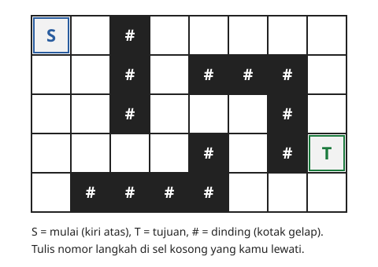

**Ingat dulu:** Tanpa melihat catatan: (1) mengapa pencarian biner mensyaratkan larik terurut, dan berapa langkahnya untuk 1000 elemen? (2) tulis kerangka bukti induksi (pangkal dan langkah) untuk 1 + 2 + ... + n = n(n+1)/2.



`[Gambar: peta grid lima baris dan delapan kolom. S di kiri atas adalah awal, T di kanan pada baris keempat adalah tujuan, kotak gelap bertanda # adalah dinding. Sel lain dibiarkan kosong untuk menulis nomor langkah. Gerak empat arah, tiap langkah berbiaya 1.]`

**Prediksi (bagian 5):** Tebak langkah minimum dari S ke T pada peta di gambar, lalu telusuri dengan pensil dan tulis nomor langkah di tiap sel yang dilewati jalur terpendek, mulai dari S sebagai 0.

Tebakanku: ______ Hasil penelusuranku: ______

**Lengkapi (bagian 1):** Hitung dengan tangan.

```cpp setengah-jadi
for (int i = 1; i <= n; i *= 2)
    for (int j = 0; j < n; j++) c++;
// luar berjalan ___ kali; dalam ___ kali tiap putaran; total Theta(___)
```

**Lengkapi (bagian 3):** Pencarian biner rekursif.

```cpp setengah-jadi
int cariBiner(const vector<int> &a, int lo, int hi, int t) {
    if (lo > hi) return ___;
    int mid = (lo + hi) / 2;
    if (a[mid] == t) return mid;
    if (a[mid] < t) return cariBiner(a, ___, hi, t);
    return cariBiner(a, lo, ___, t);
}
```

**Lengkapi (bagian 4):** Tabel LCS untuk `ab` (baris) dan `ba` (kolom). Baris dan kolom 0 berisi 0.

| | "" | b | a |
| --- | --- | --- | --- |
| "" | 0 | 0 | 0 |
| a | 0 | | |
| b | 0 | | |

**Latihan:**

1. (bagian 3) Delapan kegiatan (mulai, selesai): (1,4), (3,5), (0,6), (5,7), (3,9), (5,9), (6,10), (8,11). Dua kegiatan boleh dipilih bila yang satu mulai pada atau sesudah yang lain selesai. Tulis kegiatan yang kamu pilih dan jumlahnya.

   ______

2. (bagian 3 dan 4) Koin 1, 3, 4 dan uang 6: berapa koin paling sedikit, dan berapa bila selalu mengambil koin terbesar?

   Paling sedikit: ______ Selalu terbesar: ______

3. (bagian 4) Ransel 0/1, barang (berat, nilai) = (2,3), (3,4), (4,6), kapasitas 5. Berapa nilai terbesar, dan barang mana yang diambil?

   ______

4. (bagian 2) Uraikan `T(n) = 3T(n/3) + n` di kertas sampai pola terlihat, lalu tulis notasinya.

   ______

5. (bagian 6) Apa beda masalah yang dapat diverifikasi cepat dan yang dapat dipecahkan cepat?

   ______

**Cek diri:**

- [ ] Aku dapat menghitung langkah dan menulis notasinya.
- [ ] Aku dapat menulis keadaan, rekurens, dan kasus dasar DP.
- [ ] Aku dapat menyebut tanda masalah yang dicurigai sulit.

**Catatan cetak (untuk dosen, tidak dicetak):** sekitar 3 halaman A4. Kunci ada di modul `kul-i-201` bagian "Kunci dan petunjuk". Lembar tidak memuat kolom identitas.
