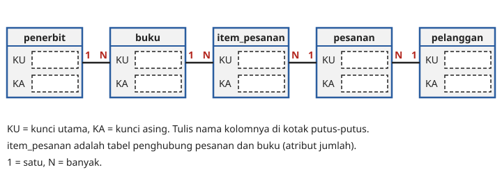

**Ingat dulu:** Tanpa melihat catatan: (1) mengapa pencarian di tabel hash bisa jadi lambat walau ember banyak? (2) sebut biaya pencarian BST seimbang dan terburuknya, dan data yang membuatnya terburuk.



`[Gambar: lima tabel berderet: penerbit, buku, item_pesanan, pesanan, pelanggan, dihubungkan garis berlabel 1 dan N (penerbit 1 ke N buku, buku 1 ke N item_pesanan, pesanan 1 ke N item_pesanan, pelanggan 1 ke N pesanan). Tiap tabel punya dua kotak putus-putus kosong: KU untuk kunci utama dan KA untuk kunci asing.]`

**Prediksi (bagian 4):** Tabel `rekening(id, saldo)` dengan `CHECK (saldo >= 0)`. Rekening 1 berisi 100, rekening 2 berisi 0. Transaksi pertama memindahkan 70 dari rekening 1 ke rekening 2 (tambah ke 2 dulu). Transaksi kedua memindahkan 50 dari rekening 2 ke rekening 1, lalu mengurangi 50 lagi dari rekening 2, dan diakhiri `ROLLBACK`. Tulis saldo sesudah tiap transaksi.

| | Rekening 1 | Rekening 2 |
| --- | --- | --- |
| Sesudah transaksi pertama | | |
| Sesudah transaksi kedua | | |

**Lengkapi (bagian 1):** Tabel `ulasan`: satu ulasan per pasangan pelanggan-buku, nilai 1 sampai 5.

```sql setengah-jadi
CREATE TABLE ulasan (
    pelanggan_id INTEGER NOT NULL REFERENCES pelanggan (___),
    buku_id INTEGER NOT NULL REFERENCES ___ (id),
    nilai INTEGER NOT NULL CHECK (nilai BETWEEN ___ AND ___),
    PRIMARY KEY (___, ___)
);
```

**Lengkapi (bagian 3):** Tabel `jadwal(kelas, hari, dosen, ruang)` berkunci `(kelas, hari)`. Fakta: `dosen` dan `ruang` hanya bergantung pada `kelas`. Tentukan 2NF-nya.

```sql setengah-jadi
-- ketergantungan: kelas -> ___, ___
-- pelanggaran: atribut non-kunci bergantung pada ___ dari kunci
-- hasil dekomposisi:
--   kelas_info(kelas, ___, ___)   kunci: ___
--   jadwal_hari(___, ___)         kunci: gabungan
```

**Lengkapi (bagian 5):** Indeks gabungan untuk "akses pengguna tertentu pada jalur tertentu" pada tabel `log_akses`.

```sql setengah-jadi
CREATE INDEX idx_pengguna_jalur ON log_akses (___, ___);
EXPLAIN QUERY PLAN SELECT * FROM log_akses
WHERE pengguna = 'u0042' AND jalur = '/hal/3';
-- strategi yang diharapkan: SEARCH ... USING INDEX ___
```

**Latihan:**

1. (bagian 1) Pada gambar, tulis kolom kunci utama dan kunci asing tiap tabel.
2. (bagian 2) Tulis kueri SQL untuk nama pelanggan yang belum pernah memesan (tabel `pelanggan` dan `pesanan`, kolom `pesanan.pelanggan_id`).

   ______

3. (bagian 2) Mengapa `WHERE kota = NULL` tak pernah mengembalikan baris, dan apa penggantinya?

   ______

4. (bagian 3) `pegawai(id, nama, departemen, kepala_departemen)`: tunjuk ketergantungan transitif dan tulis dekomposisi 3NF.

   ______

5. (bagian 5) Apa beda `SCAN` dan `SEARCH` pada rencana kueri, dan mengapa terlalu banyak indeks memperlambat `INSERT`?

   ______

**Cek diri:**

- [ ] Aku dapat memodelkan data (ER) dan menurunkannya ke tabel dengan kunci.
- [ ] Aku dapat menulis transaksi dan menjelaskan ACID.
- [ ] Aku dapat membaca rencana kueri dan memutuskan indeks.

**Catatan cetak (untuk dosen, tidak dicetak):** sekitar 3 halaman A4. Kunci ada di modul `kul-i-202` bagian "Kunci dan petunjuk". Lembar tidak memuat kolom identitas.
