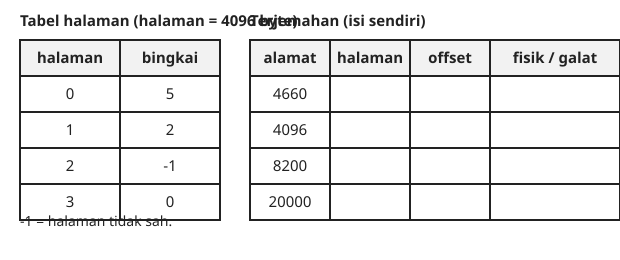

**Ingat dulu:** Tanpa melihat catatan: (1) apa yang dilakukan `*p` dan apa yang dilakukan `&x`? (2) mengapa `int f(int x)` yang mengubah `x` tidak mengubah variabel pemanggil?



`[Gambar: di kiri tabel halaman berukuran halaman 4096 byte: halaman 0 ke bingkai 5, halaman 1 ke bingkai 2, halaman 2 bernilai -1 (tidak sah), halaman 3 ke bingkai 0. Di kanan tabel terjemahan dengan kolom alamat berisi 4660, 4096, 8200, 20000, dan kolom halaman, offset, serta fisik atau galat yang kosong.]`

**Prediksi (bagian 4):** Terjemahkan keempat alamat pada gambar: tulis nomor halaman, offset, dan alamat fisik, atau "galat halaman" bila halamannya tidak sah.

**Lengkapi (bagian 1):** Komplemen dua dan luapan.

```text setengah-jadi
// 1. 8-bit komplemen dua dari -5: balik bit 5 (00000101) -> ___, tambah 1 -> ___
// 2. nilai bertanda dari 11111111 (8-bit komplemen dua) = ___
// 3. uint8_t x = 250; x += 10; // x menjadi ___
// 4. alamat elemen int berindeks 3 pada larik di alamat 1000 (int 4 byte) = ___
```

**Lengkapi (bagian 2):** 2^7 dengan tujuh kali penggandaan, keluar dengan hasilnya (harus kurang dari 256).

```text setengah-jadi
_start:
    mov rax, ___
    mov rcx, 7
ulang:
    add rax, ___
    dec ___
    jnz ulang
    mov rdi, rax
    mov rax, 60
    syscall
```

**Latihan:**

1. (bagian 4) Rangkaian acuan `3 1 4 1 5 2 6 5 3 5` dengan 3 bingkai. Isi isi bingkai FIFO tiap acuan, lalu hitung galatnya.

   | Acuan | 3 | 1 | 4 | 1 | 5 | 2 | 6 | 5 | 3 | 5 |
   | --- | --- | --- | --- | --- | --- | --- | --- | --- | --- | --- |
   | Bingkai 1 | | | | | | | | | | |
   | Bingkai 2 | | | | | | | | | | |
   | Bingkai 3 | | | | | | | | | | |

   Galat FIFO: ______

2. (bagian 3) Empat proses tiba pada waktu 0 dengan lama kerja 5, 3, 8, 2. Hitung dengan tangan waktu tunggu rata-rata *round robin* berkuantum 2.

   ______

3. (bagian 3) Hitung waktu tunggu rata-rata FCFS untuk *burst* 4, 1, 3.

   ______

4. (bagian 3) Mengapa utas dalam satu proses dapat saling mengganggu, sedangkan dua proses tidak?

   ______

5. (bagian 5) Apa beda tautan keras dan salinan (`cp`) saat salah satu berkas diubah?

   ______

**Cek diri:**

- [ ] Aku dapat mengubah bilangan antara biner dan komplemen dua.
- [ ] Aku dapat menelusuri program assembly pendek dengan tabel register.
- [ ] Aku dapat menerjemahkan alamat virtual dengan tabel halaman.

**Catatan cetak (untuk dosen, tidak dicetak):** sekitar 3 halaman A4. Kunci ada di modul `kul-i-203` bagian "Kunci dan petunjuk". Lembar tidak memuat kolom identitas.
