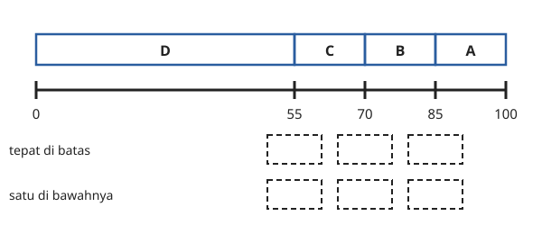

**Ingat dulu:** Tanpa melihat catatan: (1) apa arti kode keluar 0 dan kode keluar bukan 0 suatu program? (2) apa beda `git add` dan `git commit`?



`[Gambar: garis skor dari 0 sampai 100 dengan batas 55, 70, dan 85. Pita di atas garis berlabel D (di bawah 55), C (dari 55), B (dari 70), A (dari 85). Di bawah batas 55, 70, dan 85 ada dua kotak putus-putus kosong: satu untuk skor uji tepat di batas dan satu untuk skor uji satu di bawahnya.]`

**Prediksi (bagian 1):** Kebutuhan: "pembelian minimal Rp 100.000 mendapat diskon 10%". Tanpa menjalankan, tulis keluaran program ini dan putuskan apakah sesuai kebutuhan.

```ts
function diskon(total: number): number {
  return total > 100_000 ? Math.floor(total / 10) : 0;
}

console.log(diskon(100_000), diskon(100_001), diskon(50_000));
```

Keluaranku: ______ Sesuai kebutuhan? ______

**Lengkapi (bagian 2):** Uji batas untuk `nilaiHuruf` (A untuk 85 ke atas, B untuk 70, C untuk 55, selain itu D). Pakai gambar: isi dulu kotak skor uji di bawah garis, lalu salin ke sini.

```ts setengah-jadi
function nilaiHuruf(skor: number): "A" | "B" | "C" | "D" {
  if (skor < 0 || skor > 100) throw new RangeError("skor di luar 0-100");
  if (skor >= 85) return "A";
  if (skor >= 70) return "B";
  if (skor >= 55) return "C";
  return "D";
}

test("batas B dan C", () => {
  expect(nilaiHuruf(___)).toBe("B");
  expect(nilaiHuruf(___)).toBe("C");
});

test("di luar rentang", () => {
  expect(() => nilaiHuruf(___)).toThrow();
});
```

**Lengkapi (bagian 3):** Membuat cabang, menyimpan perubahan, lalu menggabungkan.

```bash setengah-jadi
git ___ -c fitur/ongkir
git add ___
git commit -m "___"
git switch main
git merge --no-ff ___
```

**Latihan:**

1. (bagian 1) Tulis tiga kriteria penerimaan untuk "pengguna dapat menghapus catatan", lengkap dengan contoh angka atau kejadian.

   ______

2. (bagian 2) Tulis `maksimum(nilai)` beserta uji untuk daftar kosong, satu elemen, dan semua elemen sama.

   ______

3. (bagian 2) Beri tiga komentar tinjau kode untuk fungsi `rataRata` yang membagi jumlah dengan `nilai.length` tanpa memeriksa daftar kosong, masing-masing dengan alasan.

   ______

4. (bagian 4) Tulis spesifikasi dan empat uji untuk `hargaCetak(halaman)` (Rp 300 per halaman, minimal 5 halaman) sebelum meminta bantuan apa pun.

   ______

5. (bagian 4) Mengapa log pemakaian AI mencatat perintah dan bagian keluaran yang dipakai?

   ______

**Cek diri:**

- [ ] Aku dapat menulis kriteria penerimaan dan uji kasus batas dari kebutuhan.
- [ ] Aku dapat meninjau kode dan menjalankan gerbang CI lokal.
- [ ] Aku dapat memverifikasi kode hasil AI dan mengisi log.

**Catatan cetak (untuk dosen, tidak dicetak):** sekitar 3 halaman A4. Kunci ada di modul `kul-i-204` bagian "Kunci dan petunjuk". Lembar tidak memuat kolom identitas.
