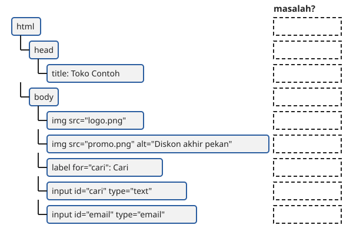

**Ingat dulu:** Tanpa melihat catatan: (1) mengapa kueri SQL tidak boleh disusun dengan menyambung masukan pengguna ke string, dan apa gantinya? (2) apa beda `INNER JOIN` dan `LEFT JOIN`?



`[Gambar: pohon elemen halaman contoh. html berisi head (title "Toko Contoh") dan body. Body berisi gambar logo.png tanpa atribut alt, gambar promo.png dengan alt "Diskon akhir pekan", label untuk "cari", input id "cari" bertipe text, dan input id "email" bertipe email. Di kanan tiap elemen ada kotak putus-putus kosong berlabel "masalah?".]`

**Prediksi (bagian 1):** Pemeriksa aksesibilitas memeriksa tiga hal: bahasa halaman (`lang`), teks pengganti gambar (`alt`), dan label untuk setiap isian. Pada gambar, tulis di kotak masalah apa yang akan dilaporkan untuk tiap elemen (kosongkan bila tidak ada).

**Lengkapi (bagian 1):** Isi nama atribut yang hilang.

```html setengah-jadi

<label ___="nama">Nama</label>
<input ___="nama" type="text">
```

**Lengkapi (bagian 2):** Validasi data luar bertipe `unknown`.

```ts setengah-jadi
function bacaNama(x: unknown): string | null {
  if (typeof x !== "___") return null;
  const nama = x.___();
  return nama === "" ? null : nama;
}
```

**Lengkapi (bagian 4):** Kueri berparameter.

```ts setengah-jadi
const nama = "bima";
const baris = db.query("SELECT peran FROM pengguna WHERE nama = ___").all(___);
console.log(baris.length);
```

**Latihan:**

1. (bagian 2) Tulis urutan huruf yang tercetak dan alasannya.

   ```ts
   console.log("A");
   setTimeout(() => console.log("B"), 0);
   Promise.resolve().then(() => console.log("C"));
   console.log("D");
   ```

   Urutan: ______ Alasan: ______

2. (bagian 3) Beri kode status untuk tiap kejadian.

   | Kejadian | Status |
   | --- | --- |
   | sumber dibuat | |
   | badan permintaan tak sah | |
   | sumber tak ada | |
   | metode tak didukung | |

3. (bagian 3) Apa arti 429 dan kapan peladen memberikannya?

   ______

4. (bagian 3) Rancang API "catatan" dengan lima operasi **sebelum** menulis kode.

   | Jalur | Metode | Status sukses | Status galat |
   | --- | --- | --- | --- |
   | | | | |
   | | | | |
   | | | | |
   | | | | |
   | | | | |

5. (bagian 4) Mengapa pesan galat login sebaiknya sama untuk "nama tidak ada" dan "sandi salah"?

   ______

**Cek diri:**

- [ ] Aku dapat menulis HTML semantik yang aksesibel.
- [ ] Aku dapat merancang dan membangun API dengan status yang benar.
- [ ] Aku dapat menutup injeksi, XSS, dan menyimpan sandi dengan benar.

**Catatan cetak (untuk dosen, tidak dicetak):** sekitar 3 halaman A4. Kunci ada di modul `kul-i-205` bagian "Kunci dan petunjuk". Lembar tidak memuat kolom identitas.
