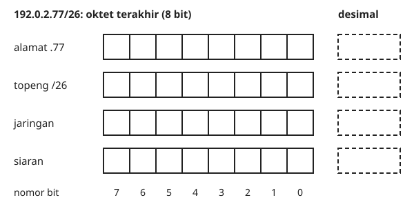

**Ingat dulu:** Tanpa melihat catatan: (1) bagaimana program meminta layanan kernel lewat system call, dan apa yang dikerjakan `write`? (2) hitung 3^200 mod 7 dengan kuadrat berulang atau siklus pangkat, dan tulis -7 mod 5 menurut matematika.



`[Gambar: empat baris petak delapan bit untuk oktet terakhir alamat 192.0.2.77/26, berlabel "alamat .77", "topeng /26", "jaringan", dan "siaran", dengan nomor bit 7 sampai 0 di bawahnya. Di kanan tiap baris ada satu kotak putus-putus kosong untuk nilai desimal. Semua petak kosong untuk diisi.]`

**Prediksi (bagian 1):** Untuk `192.0.2.77/26`, isi petak pada gambar sampai ketemu alamat jaringan dan alamat siaran, lalu tulis banyak host.

Alamat jaringan: ______ Alamat siaran: ______ Banyak host: ______

**Lengkapi (bagian 1):**

```text setengah-jadi
// 192.0.2.200/25: bit host = ___, banyak alamat = ___, host terpakai = ___
// alamat jaringan: 200 & ~127 = ___ ; alamat siaran = ___
// byte 0x45 0x00 0x00 0x1c, dua kata 16-bit dijumlah = 0x___ ; dibalik = 0x___
```

**Lengkapi (bagian 3):** HMAC dan pembandingan waktu konstan.

```python setengah-jadi
def tanda(kunci: bytes, pesan: bytes) -> str:
    return hmac.new(kunci, pesan, hashlib.___).hexdigest()

def sah(kunci: bytes, pesan: bytes, diterima: str) -> bool:
    return hmac.___(tanda(kunci, pesan), diterima)
```

**Lengkapi (bagian 4):** Tulis jenis cacat pada tiap baris.

```python setengah-jadi
def hapus(nama):
    os.system("rm -rf /data/unggahan/" + nama)   # cacat 1: ___
    return open("/data/laporan/" + nama).read()  # cacat 2: ___

KUNCI = "abc123-kunci-produksi"                  # cacat 3: ___
```

**Latihan:**

1. (bagian 1) Untuk `192.0.2.200/26`, tulis alamat jaringan, alamat siaran, dan jumlah host.

   ______

2. (bagian 2) Mengapa satu `recv` dapat mengembalikan setengah pesan? Tulis skenario dengan dua kiriman `send`.

   ______

3. (bagian 3) Apa beda hash, HMAC, dan enkripsi?

   ______

4. (bagian 3) Mengapa dua pengguna dengan sandi yang sama harus punya hash berbeda?

   ______

5. (bagian 5) Sebut tiga pemeriksaan sebelum memasang paket yang disarankan asisten AI.

   ______

**Cek diri:**

- [ ] Aku dapat menghitung alamat jaringan dan siaran dari CIDR.
- [ ] Aku dapat menulis klien-peladen TCP dengan pembingkaian dan galat diperiksa.
- [ ] Aku dapat menemukan injeksi, penelusuran jalur, luapan, dan paket fiktif.

**Catatan cetak (untuk dosen, tidak dicetak):** sekitar 3 halaman A4. Kunci ada di modul `kul-i-301` bagian "Kunci dan petunjuk". Lembar tidak memuat kolom identitas.
