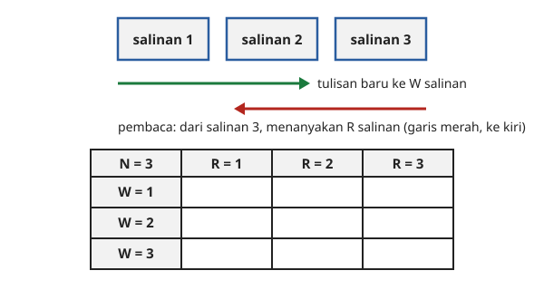

**Ingat dulu:** Tanpa melihat catatan: (1) mengapa `x++` dari beberapa utas tanpa kunci dapat memberi hasil salah, dan apa dua cara memperbaikinya? (2) mengapa satu `recv` dapat mengembalikan setengah pesan, dan bagaimana peladen memberi batas pesan?



`[Gambar: tiga salinan data bernomor 1, 2, 3 (N = 3). Panah hijau: tulisan baru mulai dari salinan 1 ke kanan sampai W salinan. Panah merah: pembaca menanyakan mulai dari salinan 3 ke kiri sebanyak R salinan. Di bawahnya tabel baris W = 1, 2, 3 dan kolom R = 1, 2, 3 dengan sembilan sel kosong untuk menulis "baru" atau "awal".]`

**Prediksi (bagian 2):** `N = 3`. Awalnya semua salinan berisi `awal`. Tulisan baru (`baru`) sampai ke `W` salinan pertama, pembaca menanyakan `R` salinan terakhir (kasus terburuk). Isi tiap sel pada gambar dengan nilai yang dilihat pembaca: `baru` atau `awal`. Lalu periksa apakah syarat `W + R > N` cocok dengan tebakanmu.

Syarat `W + R > N` cocok? ______

**Lengkapi (bagian 1):** Antrean terbatas dengan variabel kondisi.

```cpp setengah-jadi
void taruh(int x) {
    unique_lock<mutex> jaga(kunci);
    tidak_penuh.wait(jaga, [&] { return isi.size() < ___; });
    isi.push(x);
    tidak_kosong.___();
}
```

**Lengkapi (bagian 2):**

```text setengah-jadi
// N = 5, W = 3: R minimum agar selalu melihat tulisan terbaru = ___
// N = 5, R = 1: W minimum = ___ ; tulisan baru harus ke semua salinan dulu
// bila satu salinan mati, tulisan dengan W = N ___ (berhasil / gagal)
```

**Lengkapi (bagian 3):** Tulis cacat pada tiap baris Dockerfile.

```text setengah-jadi
FROM ubuntu:latest                        # cacat 1: ___
COPY . /app                               # cacat 2: ___
RUN echo "KUNCI_API=abc123" > /app/.env   # cacat 3: ___
CMD ["/app/jalan"]                        # cacat 4 (pengguna): ___
```

**Latihan:**

1. (bagian 1) Mengapa dua `lock_guard` dengan urutan berlawanan dapat membeku, dan apa yang dilakukan `scoped_lock`?

   ______

2. (bagian 1) Berapa percepatan maksimum menurut hukum Amdahl bila 20% program serial dan prosesornya sangat banyak? Tulis rumusnya.

   ______

3. (bagian 2) Beri satu contoh aplikasi yang cukup dengan konsistensi akhir dan satu yang tidak, dengan alasannya.

   ______

4. (bagian 3) Apa beda kontainer dan mesin virtual, dan apa arti kode keluar 137?

   ______

5. (bagian 4) Dengan harga fiktif 0,05 per jam dan 0,09 per GB data keluar: hitung biaya layanan 100 jam per bulan, biaya 200 GB data keluar, dan biaya pemicu peringatan anggaran 80% dari batas 50.

   ______

**Cek diri:**

- [ ] Aku dapat menemukan dan memperbaiki balapan data dan kebuntuan.
- [ ] Aku dapat menalar kuorum dan konsistensi akhir pada contoh kecil.
- [ ] Aku dapat menulis Dockerfile aman dan membatasi sumber dayanya.

**Catatan cetak (untuk dosen, tidak dicetak):** sekitar 3 halaman A4. Kunci ada di modul `kul-i-302` bagian "Kunci dan petunjuk". Lembar tidak memuat kolom identitas.
