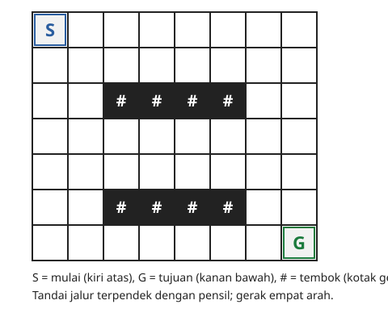

**Ingat dulu:** Tanpa melihat catatan: (1) mengapa BFS memberi jalur terpendek pada grid tanpa bobot, dan mengapa memori BFS bisa besar? (2) apa beda masalah yang dapat diverifikasi cepat dan yang dapat dipecahkan cepat? Beri satu contoh.



`[Gambar: grid tujuh baris dan delapan kolom. S di kiri atas adalah awal, G di kanan bawah adalah tujuan, kotak gelap bertanda # adalah tembok (kolom ketiga sampai keenam pada baris ketiga dan baris keenam). Sel lain kosong untuk menandai jalur. Gerak empat arah, tiap langkah berbiaya 1.]`

**Prediksi (bagian 1):** Pada grid, berapa panjang jalur terpendek dari S ke G? Gambar jalurnya dengan pensil. Lalu tebak: mana yang membuka lebih banyak sel, BFS atau A\*?

Panjang jalur: ______ Lebih banyak sel dibuka: ______

**Lengkapi (bagian 1):**

```text setengah-jadi
// grid kosong 5x5, S di (0,0), G di (4,4):
// jarak terpendek = ___ ; h(S) = ___ ; apakah A* dengan h = 0 sama dengan BFS? ___
// bila h melebihi biaya nyata (mis. h = 3 * Manhattan), hasil A* menjadi ___
```

**Lengkapi (bagian 2):** Turun gradien untuk regresi linear.

```python setengah-jadi
for _ in range(5000):
    e = w * x + b - y
    w -= ___ * np.mean(e * x)
    b -= ___ * np.mean(___)
# laju belajar 2.0 pada data ini: ___
```

**Lengkapi (bagian 6):**

```text setengah-jadi
// energi_kwh(400, 10, 1.2) = ___ kWh ; bila PUE sebenarnya 1.6, selisihnya ___ %
// laporan jujur: "perkiraan ___ sampai ___ kWh, dengan asumsi ___"
```

**Latihan:**

1. (bagian 3) Presisi dan recall bila TP = 6, FP = 2, FN = 4. Tulis rumusnya.

   | | Ditebak positif | Ditebak negatif |
   | --- | --- | --- |
   | Sebenarnya positif | TP = 6 | FN = 4 |
   | Sebenarnya negatif | FP = 2 | |

   Presisi: ______ Recall: ______

2. (bagian 3) Penguji "95% akurat" memeriksa penyakit yang diderita 1% orang. Dari yang positif, berapa persen benar-benar sakit? Tulis hitunganmu.

   ______

3. (bagian 2) Mengapa laju belajar terlalu besar dapat membuat turun gradien gagal?

   ______

4. (bagian 4) Mengapa tak ada satu garis yang memisahkan XOR (`00→0`, `01→1`, `10→1`, `11→0`)? Berapa parameter jaringan dengan 4 neuron tersembunyi?

   ______

5. (bagian 5) Mengapa akurasi keseluruhan dapat menyembunyikan bias?

   ______

**Cek diri:**

- [ ] Aku dapat menjelaskan A\* dan melatih lalu menguji model pada data uji.
- [ ] Aku dapat memeriksa metrik per kelompok.
- [ ] Aku dapat menulis perkiraan biaya dengan rentang dan asumsi.

**Catatan cetak (untuk dosen, tidak dicetak):** sekitar 3 halaman A4. Kunci ada di modul `kul-i-303` bagian "Kunci dan petunjuk". Lembar tidak memuat kolom identitas.
