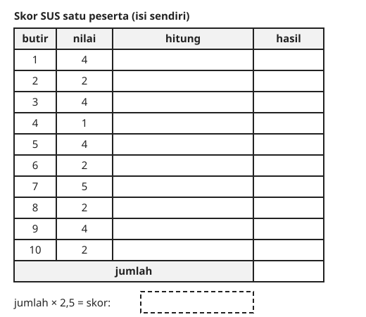

**Ingat dulu:** Tanpa melihat catatan: (1) sebut tiga pemeriksaan aksesibilitas dasar yang dapat dijalankan mesin pada HTML; (2) sebut empat pertanyaan penelaah dalam tinjau kode.



`[Gambar: tabel sepuluh butir kuesioner SUS dengan nilai jawaban satu peserta fiktif berturut-turut 4, 2, 4, 1, 4, 2, 5, 2, 4, 2. Kolom "hitung" dan "hasil" kosong, lalu satu baris "jumlah" dan satu kotak kosong untuk skor akhir setelah jumlah dikali 2,5.]`

**Prediksi (bagian 2):** Hitung skor SUS peserta fiktif pada gambar dengan tangan. Butir bernomor ganjil dihitung `nilai - 1`, butir bernomor genap `5 - nilai`, lalu jumlahnya dikali 2,5. Tulis hitunganmu di kolom hitung.

Skorku: ______

**Lengkapi (bagian 1):** Pesan untuk kata sandi yang terlalu pendek, tanpa menyalahkan pengguna.

```ts setengah-jadi
function pesanSandi(sandi: string): string | null {
  if (sandi.length >= ___) return null;
  return `Kata sandi perlu minimal ___ karakter; kamu menulis ${sandi.length}. Tambahkan ___.`;
}
```

**Lengkapi (bagian 2):** Laporan satu temuan.

```text setengah-jadi
Temuan: peserta tidak menemukan tombol ___ pada tugas ___.
Bukti: ___ dari 5 peserta gagal; P03 berkata "___".
Heuristik terkait: nomor ___.
Usulan perbaikan: ___.
```

**Lengkapi (bagian 3):** Pilih warna teks di atas putih yang lulus 4,5:1.

```ts setengah-jadi
const r = kontras("#___", "#ffffff");
console.log(r >= ___ ? "lulus" : "gagal");
```

**Latihan:**

1. (bagian 1) Tulis ulang pesan "Masukan tidak valid." untuk isian email yang belum berbentuk `nama@contoh.example`, sehingga menyebut isian, salahnya, dan perbaikannya.

   ______

2. (bagian 2) Mengapa satu rata-rata skor SUS dari lima peserta menyesatkan?

   ______

3. (bagian 2) Sebut tiga langkah etika menguji dengan orang.

   ______

4. (bagian 3) Abu-abu `#777777` di atas putih tampak cukup jelas. Menurutmu lulus 4,5:1? Berapa rasio untuk hitam di atas putih?

   ______

5. (bagian 3) Mengapa warna merah saja tidak cukup untuk menandai galat?

   ______

**Cek diri:**

- [ ] Aku dapat menilai antarmuka dengan sepuluh heuristik.
- [ ] Aku dapat merancang dan menjalankan uji dengan pengguna secara etis.
- [ ] Aku dapat menghitung kontras dan memeriksa aksesibilitas dasar.

**Catatan cetak (untuk dosen, tidak dicetak):** sekitar 2 halaman A4. Kunci ada di modul `kul-i-304` bagian "Kunci dan petunjuk". Lembar tidak memuat kolom identitas.
