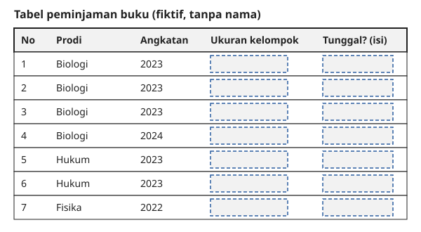

**Ingat dulu:** Tanpa melihat catatan, jawab. (1) Apa saja yang tidak boleh kamu masukkan ke layanan AI, dan mengapa? (2) Sebut satu alasan keluaran AI yang lancar belum tentu benar.

(1) ______

(2) ______



`[Gambar: tabel peminjaman buku fiktif tanpa nama, tujuh baris berisi prodi dan angkatan (Biologi 2023 tiga baris, Biologi 2024, Hukum 2023 dua baris, Fisika 2022). Dua kolom di kanan kosong: ukuran kelompok dan tunggal atau bukan. Kolom itu diisi pada soal Prediksi.]`

**Prediksi (bagian 3, pertemuan 8 sampai 10):** Tabel pada gambar tidak berisi nama, hanya prodi dan angkatan. Isi kolom ukuran kelompok pada gambar, lalu jawab: apakah ada orang yang masih dapat dikenali dari tabel itu, dan kapan?

Jawabanku: ______

**Lengkapi (bagian 3):** Fungsi berikut menyamarkan surel fiktif. Isi bagian kosong, lalu tulis keluaran untuk tiga panggilan di bawahnya.

```cpp setengah-jadi
std::string samarkan_surel(const std::string& surel) {
    const std::size_t at = surel.find('@');
    if (at == std::string::npos || at == ______) {
        return "[bukan surel]";
    }
    return surel.substr(0, 1) + "***" + surel.______(at);
}
```

| Panggilan | Keluaran |
| --- | --- |
| `samarkan_surel("ani@kampus.example")` | |
| `samarkan_surel("@kampus.example")` | |
| `samarkan_surel("tanpa-at")` | |

Hasil pertama masih memuat huruf awal dan domain. Mengapa itu belum anonim? ______

**Susun (bagian 1, pertemuan 1 sampai 4):** Lima langkah menalar kasus ada dalam urutan acak. Beri nomor 1 sampai 5.

- A. Keputusan dan alasannya, ditulis agar orang lain dapat membantahnya
- B. Pilihan: paling sedikit tiga, termasuk "tidak melakukan apa-apa"
- C. Fakta: apa yang pasti, apa yang belum diketahui
- D. Akibat dan kewajiban tiap pihak
- E. Pihak terdampak, termasuk yang tidak hadir

Urutanku: ______ , ______ , ______ , ______ , ______

**Latihan:**

1. (Bagian 1) Kasus 4 (fiktif): Bayu menemukan bahwa perusahaannya menyembunyikan kebocoran data pengguna. Isi lima langkah di kertas terpisah dengan tiga pilihan: jalur internal, regulator, publik. AI: tanpa AI.
2. (Bagian 2) Proyek timmu berlisensi MIT dan ingin memakai pustaka GPL-3.0 yang dihubungkan langsung ke program. Tulis apa yang kamu cek dulu pada teks GPL, tiga pilihanmu, dan siapa yang memutuskan di organisasimu. AI: tanpa AI.
3. (Bagian 3) Sebuah aplikasi kampus fiktif menyimpan nama, NIM, surel, dan lokasi kunjungan. Isi tabel di bawah, lalu sebutkan satu kolom yang kamu hapus dan satu yang kamu samarkan.

| Kolom | Perlu atau tidak | Alasan |
| --- | --- | --- |
| nama lengkap pengguna | | |
| NIM | | |
| surel | | |
| lokasi kunjungan | | |

Kolom yang kuhapus: ______ . Kolom yang kusamarkan: ______

4. (Bagian 5) Tulis satu kalimat tiap unsur kebijakan pemakaian AI di tempat kerja untuk organisasi mahasiswa fiktif.

| Unsur | Isi kebijakan |
| --- | --- |
| Tujuan dan batas | |
| Data | |
| Pengungkapan dan catatan | |
| Tinjauan manusia | |
| Hak cipta dan lisensi | |
| Insiden dan pengawasan | |

**Cek diri:**

- [ ] Aku dapat menganalisis kasus dengan lima langkah dan alasan yang dapat dibantah.
- [ ] Aku dapat menjelaskan data pribadi, hak subjek, dan meminimalkan data.
- [ ] Aku dapat menyusun kebijakan pemakaian AI satu halaman.

**Catatan cetak (untuk dosen, tidak dicetak):** tiga halaman A4. Kunci dan petunjuk ada di modul `kul-i-305` bagian "Kunci dan petunjuk". Etika tidak punya kunci tunggal; nilai mutu penalaran. Lembar tidak memuat kolom nama, NIM, tanggal, atau nilai.
