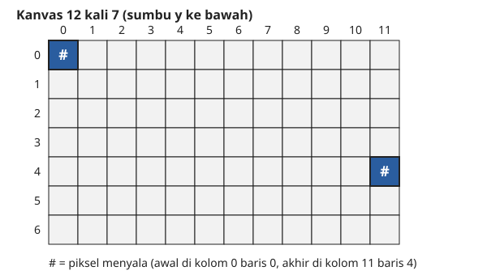

**Ingat dulu:** Tanpa melihat catatan, jawab. (1) Mengapa elemen larik dua dimensi diakses dengan dua indeks, dan apa yang terjadi bila indeks melewati batas? (2) Mengapa memilih struktur data menurut operasi yang paling sering dipakai?

(1) ______

(2) ______



`[Gambar: kisi 12 kolom (0 sampai 11) dan 7 baris (0 sampai 6), baris 0 di atas. Piksel di kolom 0 baris 0 dan di kolom 11 baris 4 sudah bertanda #. Sisa kisi kosong. Dipakai pada soal Prediksi: tandai piksel lain yang dilalui garis.]`

**Prediksi (bagian 1, pertemuan 1 sampai 5):** Garis dari `(0, 0)` ke `(11, 4)` pada kanvas 12 kali 7. Tandai dengan `#` piksel yang menurutmu menyala pada kisi di gambar. Lalu jawab:

Jumlah piksel yang dihasilkan: ______

Garis bergerak satu piksel per kolom atau per baris? ______

Garis dari `(-3, 1)` ke `(14, 1)`: dihasilkan ______ piksel, tergambar ______ piksel.

**Lengkapi (bagian 1 dan 2):** Isi bagian kosong.

```python setengah-jadi
def tepi(a, b, p):
    return (b[0] - a[0]) * (p[1] - a[1]) - (b[1] - a[1]) * (______)


# titik p di dalam segitiga bila ketiga nilai tepi memiliki tanda ______
```

```python setengah-jadi
# skala 2x mengelilingi titik (1, 1):
m = kali(geser(1, 1), kali(skala(2, 2), geser(______, ______)))
# terap(m, (3, 1)) = ______
```

| Soal | Isianmu |
| --- | --- |
| Garis (0,0) ke (7,3): jumlah titik | |
| Garis (2,5) ke (2,5): jumlah titik | |
| Garis (1,1) ke (-4,1), kanvas selebar 12: dihasilkan / tergambar | |
| skala(2, 3) pada (1, 1), lalu geser(1, 1): hasil | |
| geser(1, 1) dulu, lalu skala(2, 3): hasil | |

**Latihan:**

1. (Bagian 2) Titik `(2, 0)` diputar 90 derajat lalu digeser `(5, 0)`. Di mana ia? Bila digeser dulu lalu diputar, di mana? Mengapa berbeda? AI: tanpa AI.
2. (Bagian 2) Sudut kubus `(1, 1, 3)` dengan `f = 2`: di mana ia terproyeksi, dan bila `z` menjadi 4?
3. (Bagian 3) Kotak 4x3 di `(2, 1)` pada kanvas 16x6. Kursor ditekan di `(3, 2)`, digeser ke `(9, 3)`, lalu ke `(40, 40)` di luar kanvas, lalu dilepas. Tebak posisi kotak saat kursor di `(9, 3)` dan posisi akhirnya. AI: tanpa AI.
4. (Bagian 3) Langkah simulasi tetap 0,1 detik; satu bingkai 0,27 detik. Berapa langkah dijalankan dan berapa sisanya?
5. (Bagian 1) Jelaskan mengapa jumlah piksel segitiga tidak persis sama dengan luasnya, dan mengapa pusat piksel (`x + 0.5`) dipakai.

Jawaban 1 sampai 5 ditulis di kertas terpisah atau di ruang di bawah ini.

______

**Cek diri:**

- [ ] Aku dapat menggambar garis dan segitiga di framebuffer dan menjelaskan guntingnya.
- [ ] Aku dapat menyusun matriks transformasi dengan urutan yang benar.
- [ ] Aku dapat membuat visual interaktif dan mengujinya dengan deretan acara.

**Catatan cetak (untuk dosen, tidak dicetak):** dua sampai tiga halaman A4. Kunci dan petunjuk ada di modul `kul-i-306` bagian "Kunci dan petunjuk". Modul tidak memuat soal Parsons, sehingga bagian Susun dilewati. Lembar tidak memuat kolom nama, NIM, tanggal, atau nilai.
