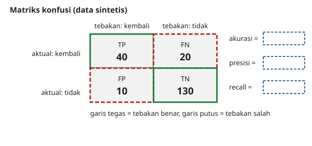

**Ingat dulu:** Tanpa melihat catatan, jawab. (1) Apa beda `INNER JOIN` dan `LEFT JOIN`, dan mengapa `COUNT(*)` dan `COUNT(kolom)` bisa berbeda bila ada `NULL`? (2) Mengapa kueri SQL tidak boleh disusun dengan menyambung masukan pengguna ke string, dan apa gantinya?

(1) ______

(2) ______



`[Gambar: matriks konfusi. Baris aktual kembali dan aktual tidak; kolom tebakan kembali dan tebakan tidak. Isinya TP 40, FN 20, FP 10, TN 130. Tiga kotak kosong di kanan untuk akurasi, presisi, dan recall; diisi pada soal Lengkapi.]`

**Prediksi (bagian 1):** Pembangkit membuat sekitar 1.200 baris pesanan dan menyisipkan lima cacat: satu duplikat persis, satu jumlah kosong, satu harga negatif, satu tanggal `2026-02-30`, satu pelanggan `P999` yang tak terdaftar. Berapa baris ditolak, berapa duplikat dilebur, dan berapa pesanan di basis data setelah pemuatan dijalankan dua kali?

Ditolak: ______ Dilebur: ______ Pesanan di basis data: ______

**Lengkapi (bagian 1 sampai 4):** Isi bagian kosong pada tiga contoh, lalu isi tiga kotak pada gambar.

```python setengah-jadi
db.executemany(
    """INSERT INTO pesanan VALUES (:id_pesanan, :id_pelanggan, :tanggal, :jumlah, :harga_satuan)
       ON CONFLICT(______) DO UPDATE SET jumlah = excluded.______""",
    list(diterima.values()),
)
# dijalankan dua kali pada data yang sama: jumlah baris ______ (sama atau dua kali lipat)
```

```sql setengah-jadi
-- pelanggan tanpa pesanan harus tetap muncul dengan frekuensi 0:
SELECT p.id_pelanggan, COUNT(______) AS frekuensi
FROM pelanggan p ______ JOIN pesanan o
  ON o.id_pelanggan = p.id_pelanggan AND o.tanggal < :pot
GROUP BY p.id_pelanggan
-- bila syarat tanggal dipindah ke WHERE, pelanggan tanpa pesanan ______ dari hasil
```

```python setengah-jadi
rerata, simpang = X.mean(axis=0), X.std(axis=0)   # dari data ______ saja
Z = (X - ______) / ______
# berkas model berformat pickle dari sumber tak dikenal: dimuat? ______
```

Model "selalu tebak tidak kembali": recall = ______ ; presisi = ______

**Latihan:**

1. (Bagian 2) Aturan "pernah memesan dalam 30 hari terakhir berarti akan kembali" dinilai terhadap label. Berapa kira-kira akurasinya bila `hari_sejak` dihitung tanpa mengintip, dan berapa bila dihitung dari pesanan yang sudah masuk jendela label? Mengapa selisihnya mencurigakan? AI: tanpa AI.
2. (Bagian 3) Model dilatih pada titik pemotongan 2026-04-01 dan diuji pada 2026-05-01. Di data uji, 114 dari 200 pelanggan kembali. Berapa akurasi baseline? Apa yang terjadi bila urutan kolom masukan tertukar?
3. (Bagian 4) Bila `grosir` hanya 40 pelanggan, apakah akurasinya lebih stabil atau kurang stabil daripada `reguler`? Lebar selang 95% kira-kira 1 poin atau 10 poin?
4. (Bagian 5) Pada data yang lebih baru rerata `frekuensi` turun, tetap, atau naik, dan apakah itu berarti pelanggan berubah perilaku?
5. (Bagian 5) Isi kartu model:

| Unsur | Isi |
| --- | --- |
| Tujuan | |
| Batas pemakaian | |
| Metrik wajib per kelompok | |
| Tindakan bila pergeseran 0,9 simpang baku | |

Ruang jawaban 1 sampai 4: ______

**Cek diri:**

- [ ] Aku dapat membangun alur ETL yang idempoten dengan catatan penolakan.
- [ ] Aku dapat membuat fitur tanpa kebocoran dan memakai model dengan kontrak masukan.
- [ ] Aku dapat melaporkan metrik per kelompok dengan baseline dan rentang.

**Catatan cetak (untuk dosen, tidak dicetak):** tiga halaman A4. Modul tidak memuat soal Parsons, sehingga bagian Susun dilewati. Kunci dan petunjuk ada di modul `kul-i-307` bagian "Kunci dan petunjuk". Lembar tidak memuat kolom nama, NIM, tanggal, atau nilai.
