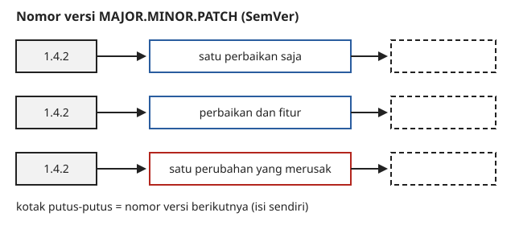

**Ingat dulu:** Tanpa melihat catatan, jawab. (1) Sebut empat pertanyaan penelaah dalam tinjau kode. (2) Sebut tiga bukti iterasi di repositori tim, dan mengapa penilaian rekan bukan satu-satunya dasar nilai perorangan.

(1) ______

(2) ______



`[Gambar: tiga baris. Tiap baris: kotak versi sekarang 1.4.2, panah, jenis perubahan (satu perbaikan saja; perbaikan dan fitur; satu perubahan yang merusak), panah, kotak kosong putus-putus untuk nomor versi berikutnya. Diisi pada soal Prediksi.]`

**Prediksi (bagian 2, iterasi kerja tim):** Versi sekarang 1.4.2. Isi tiga kotak pada gambar. Lalu jawab: bila catatan perubahan belum memuat nomor itu, apakah rilis boleh? ______

**Prediksi (bagian 1, perencanaan):** Tujuh tugas dengan jumlah perkiraan "paling mungkin" 90 jam. Tim punya kapasitas 108 jam (3 iterasi, 4 anggota, 9 jam per anggota per iterasi). Apakah aman? Tebak peluang selesai: 95%, 80%, atau 60%? ______

**Lengkapi:**

```python setengah-jadi
def total_pesanan(baris):
    jumlah = 0
    for jml, harga in baris:
        jumlah += jml * harga
    return jumlah / len(baris)   # komentar penelaah: ______
```

| Soal | Isianmu |
| --- | --- |
| Empat pertanyaan penelaah: benar? teruji? terbaca? aman? | |
| Perubahan: tombol berubah nama dan API lama dihapus. Versi 2.3.1 menjadi | |
| Tugas (4, 6, 14 jam): bentuk perkiraan jujurnya | |
| Satu kriteria penerimaan yang dapat diuji untuk masalah "anggota kesulitan memesan barang koperasi dan laporan dibuat tangan" | |
| Satu hal yang tidak dikerjakan di iterasi 1 | |

**Latihan:**

1. (Bagian 3) Enam permintaan penggabungan fiktif. Tulis mana yang dapat digabung menurut kebijakan tim (tinjauan manusia wajib, CI lulus, log AI lengkap dan tanpa rahasia): 41 (penulis A, penelaah B, CI lulus); 42 (penulis A, tanpa penelaah, AI dipakai); 43 (penulis B, penelaahnya B sendiri); 44 (CI gagal, AI dipakai, log ada); 45 (AI dipakai, log memuat `token: abc123`); 46 (satu-satunya penelaah adalah `ci-bot`). AI: tanpa AI.
2. (Bagian 3) Isi kebijakan AI tim koperasi: AI boleh untuk ______ ; tidak boleh untuk ______ . Tiga hal yang tidak pernah dimasukkan ke layanan AI: ______ ; ______ ; ______ . Bila PR memakai AI tanpa log: ______
3. (Bagian 4) Tiga bagian README yang wajib: ______ ; ______ ; ______ . Tiga bukti iterasi di repositori tim: ______ ; ______ ; ______
4. (Bagian 4) Ringkasan bukti dari 16 catatan fiktif di tiga iterasi: apakah Anggota-A, dengan catatan terbanyak, otomatis berhak nilai tertinggi? Jelaskan. AI: tanpa AI.
5. (Bagian 1) Mengapa tim sebaiknya menyepakati urutan yang dikorbankan lebih dulu sebelum iterasi dimulai?

Ruang jawaban: ______

**Cek diri:**

- [ ] Aku dapat memecah pekerjaan dan melaporkan perkiraan berentang.
- [ ] Aku dapat menjalankan tinjau kode, CI, dan rilis dengan nomor versi benar.
- [ ] Aku dapat menulis kebijakan AI tim dan mengisi log pemakaian.

**Catatan cetak (untuk dosen, tidak dicetak):** tiga halaman A4. Modul tidak memuat soal Parsons, sehingga bagian Susun dilewati. Kunci dan petunjuk ada di modul `kul-i-401` bagian "Kunci dan petunjuk". Lembar tidak memuat kolom nama, NIM, tanggal, atau nilai.
