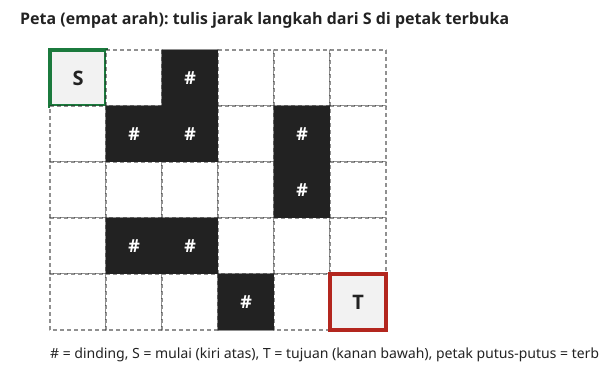

**Ingat dulu:** Tanpa melihat catatan dan tanpa komputer, jawab. (1) Tulis BFS dengan queue dan penanda kunjungan. Mengapa penanda itu perlu? (2) Mengapa pencarian biner mensyaratkan larik terurut, dan berapa langkahnya untuk 1000 elemen?

(1) ______

(2) ______



`[Gambar: kisi 5 baris kali 6 kolom. Baris 0: S . # . . . ; baris 1: . # # . # . ; baris 2: . . . . # . ; baris 3: . # # . . . ; baris 4: . . . # . T. Tanda # dinding, titik petak terbuka yang dikosongkan untuk menulis jarak. Dipakai pada soal Prediksi bagian 5 dan Latihan 3.]`

**Prediksi (bagian 5, pertemuan 12 sampai 14):** Gerak hanya empat arah. Tulis jarak langkah dari S pada petak terbuka di gambar yang kamu yakini. Berapa langkah terpendek dari S ke T? ______ Berapa komponen terhubung daerah terbuka? ______

**Prediksi (bagian 1, pertemuan 1 dan 2):** Tanpa menjalankan, tulis empat bilangan yang dicetak program ini.

```cpp
#include <algorithm>
#include <iostream>
#include <vector>
using namespace std;

int main() {
    vector<int> a = {5, 1, 4, 1, 3};
    sort(a.begin(), a.end());
    int lo = static_cast<int>(lower_bound(a.begin(), a.end(), 4) - a.begin());
    int banyak1 = static_cast<int>(upper_bound(a.begin(), a.end(), 1) -
                                   lower_bound(a.begin(), a.end(), 1));
    sort(a.begin(), a.end(), greater<int>());
    cout << lo << ' ' << banyak1 << ' ' << a[0] << ' ' << a[4] << '\n';
    return 0;
}
```

Empat bilangan: ______ ______ ______ ______

**Lengkapi:** Isi bagian kosong pada tiga potongan.

```cpp setengah-jadi
// bagian 2: indeks pertama elemen yang >= t pada larik terurut a berukuran n
int lo = 0;
int hi = n;
while (lo < hi) {
    int mid = (lo + hi) / 2;
    if (a[mid] ______ t) {
        lo = ______;
    } else {
        hi = ______;
    }
}
```

```cpp setengah-jadi
// bagian 3: kerjakan yang terpendek dulu, total = jumlah waktu selesai semua tugas
sort(lama.begin(), lama.end());
long long waktu = 0;
long long total = 0;
for (int x : lama) {
    waktu += ______;
    total += ______;
}
```

```cpp setengah-jadi
// bagian 4: banyaknya cara membayar target dengan koin c (urutan koin tidak dibedakan)
vector<long long> cara(target + 1, 0);
cara[0] = ______;
for (int c : koin) {
    for (int s = c; s <= target; s++) {
        cara[s] += cara[______];
    }
}
```

**Latihan:**

1. (Bagian 2) Larik `[7, 2, 5, 10, 8]` dibagi menjadi paling banyak 2 bagian berurutan. Jumlah terbesar di antara bagian ingin kamu buat sekecil mungkin. Berapa jawabannya? Bila `k = 3`, berapa? AI: tanpa AI.
2. (Bagian 3) Ada 8 rapat (mulai, selesai): (1,4), (3,5), (0,6), (5,7), (3,9), (5,9), (6,10), (8,11). Satu ruang, rapat yang mulai tepat saat yang lain selesai boleh. Berapa rapat paling banyak? Tulis aturan pemilihanmu. Cari contoh penyangkal untuk aturan "ambil yang paling awal mulai". AI: tanpa AI.
3. (Bagian 4) Pecahan koin `{1, 3, 4}`, target 6. Isi tabel `dp[s]` koin paling sedikit, lalu bandingkan dengan "ambil koin terbesar dulu".

| s | 0 | 1 | 2 | 3 | 4 | 5 | 6 |
| --- | --- | --- | --- | --- | --- | --- | --- |
| dp[s] | | | | | | | |

`dp[6]` = ______ koin. Greedy memakai ______ koin.

4. (Bagian 5) Jelaskan mengapa BFS dari S memberi jarak terpendek tetapi DFS tidak.
5. (Menguji sendiri) Sebut kasus uji tepi yang selalu dicoba, dan jelaskan mengapa nilai kecil dengan banyak duplikat dipilih untuk pengacak.

Ruang jawaban: ______

**Cek diri:**

- [ ] Aku dapat memperkirakan kompleksitas dari batas soal.
- [ ] Aku dapat menulis pencarian biner dan pencarian biner pada jawaban.
- [ ] Aku dapat menulis keadaan, transisi, dan urutan DP sederhana.

**Catatan cetak (untuk dosen, tidak dicetak):** tiga halaman A4. Kunci dan petunjuk ada di modul `kul-k-201` bagian "Kunci dan petunjuk". Modul tidak memuat soal Parsons, sehingga bagian Susun dilewati. Lembar tidak memuat kolom nama, NIM, tanggal, atau nilai.
