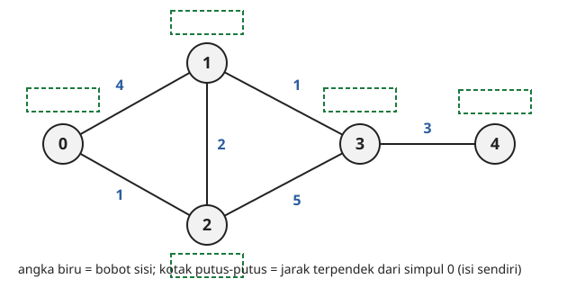

**Ingat dulu:** Tanpa melihat catatan dan tanpa komputer, jawab. (1) Tulis rekurensi DP koin dan jelaskan mengapa greedy "ambil koin terbesar" gagal pada pecahan `{1, 3, 4}` untuk target 6. (2) Apa lema jabat tangan, dan kapan graf terhubung punya jalur Euler?

(1) ______

(2) ______



`[Gambar: graf tak berarah, simpul 0 sampai 4. Sisi (bobot): 0-1 (4), 0-2 (1), 2-1 (2), 1-3 (1), 2-3 (5), 3-4 (3). Tiap simpul punya kotak kosong untuk jarak terpendek dari simpul 0. Dipakai pada soal Prediksi bagian 2.]`

**Prediksi (bagian 2, pertemuan 5 sampai 8):** Isi kotak jarak terpendek dari simpul 0 pada gambar. Lalu tulis jumlah bobot MST: ______ dan jumlah semua derajat simpul: ______ . Adakah jalur Euler pada graf ini? ______

**Prediksi (bagian 1, bagian 3, bagian 5):** Dua kata `AGGTAB` dan `GXTXAYB`: panjang LCS ______ , satu contoh urutannya ______ . Hitung dengan tangan `3^200 mod 7` = ______ dan invers 3 modulo 11 = ______ . Fungsi awalan untuk `aabaaab`:

| i | 0 | 1 | 2 | 3 | 4 | 5 | 6 |
| --- | --- | --- | --- | --- | --- | --- | --- |
| s[i] | a | a | b | a | a | a | b |
| pi[i] | | | | | | | |

**Lengkapi:** Isi bagian kosong.

```cpp setengah-jadi
// bagian 1: tas 0/1 dengan memori O(W)
vector<int> dp(W + 1, 0);
for (int i = 0; i < n; i++) {
    for (int w = W; w >= ______; w--) {
        dp[w] = max(dp[w], dp[w - berat[i]] + ______);
    }
}
```

```cpp setengah-jadi
// bagian 3: pembagian modular a / b mod p, p prima
long long bagi(long long a, long long b, long long p) {
    long long inv = pangkat(b, ______, p);
    return a % p * inv % ______;
}
```

```cpp setengah-jadi
// bagian 4: berapa himpunan tersisa
int himpunan = n;
for (auto [a, b] : pasangan) {
    if (d.______(a, b)) {
        himpunan--;
    }
}
```

```cpp setengah-jadi
// bagian 5: tiga titik segaris
bool segaris(Titik a, Titik b, Titik c) {
    return silang(______, ______, ______) == 0;
}
```

**Latihan:**

1. (Bagian 4) Larik `[5, 3, 8, 1, 4, 2]`. Berapa jumlah elemen indeks 1 sampai 3, dan jumlah semua? Sesudah elemen indeks 3 diubah menjadi 10, berapa jumlah indeks 1 sampai 3? AI: tanpa AI.
2. (Bagian 4) MST graf pada gambar dengan Kruskal (urutkan sisi menaik, ambil bila tidak membentuk lingkaran). Berapa total dan banyak sisi? Sisi mana yang ditolak?
3. (Bagian 2) Aliran maksimum: sisi (kapasitas) 0-1 (3), 0-2 (2), 1-2 (1), 1-3 (2), 2-3 (3); sumber 0, muara 3. Tulis jalur tambahan dan berapa aliran maksimum.
4. (Bagian 3) Hitung `2^10 mod 7` dengan pangkat cepat, tulis tiap langkah. Berapa bilangan prima sampai 50?
5. (Bagian 5) Poligon `(0,0)`, `(4,0)`, `(4,3)`, `(0,3)`: berapa dua kali luasnya, dan apa tanda hasil silang `(0,0)->(4,0)->(4,3)`? Berapa kali `abab` muncul dalam `abababab`?

Ruang jawaban: ______

**Cek diri:**

- [ ] Aku dapat menurunkan keadaan dan transisi DP dua dimensi dan bitmask.
- [ ] Aku dapat memakai pangkat cepat, gcd perluasan, dan invers modular.
- [ ] Aku dapat menulis argumen kebenaran dan kompleksitas tiap algoritma.

**Catatan cetak (untuk dosen, tidak dicetak):** tiga halaman A4. Kunci dan petunjuk ada di modul `kul-k-301` bagian "Kunci dan petunjuk". Modul tidak memuat soal Parsons, sehingga bagian Susun dilewati. Lembar tidak memuat kolom nama, NIM, tanggal, atau nilai.
